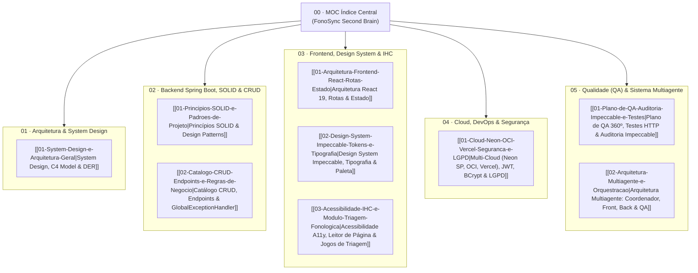

# 🧠 FonoSync — Second Brain (Mapa de Conteúdo Central)

> [!IMPORTANT] Propósito deste Cofre Obsidian
> Este é o **Segundo Cérebro (Second Brain)** oficial do ecossistema **FonoSync** — plataforma acadêmico-clínica para apoio à terapia fonoaudiológica conectando consultórios, famílias e escolas.
> Toda a base de conhecimento técnico, decisões arquiteturais, princípios **SOLID**, catálogos de **CRUD**, **Design System Impeccable**, **IHC/Acessibilidade**, infraestrutura **Multi-Cloud** e governança **Multiagente** estão interligados aqui.

---

## 🗺️ Visão Macro da Arquitetura do Conhecimento

---

## 📚 Navegação por Domínio Técnico

### 1. Arquitetura & System Design (`01-Arquitetura-e-System-Design/`)
- [[01-System-Design-e-Arquitetura-Geral|01 · System Design, Diagramas C4 e Modelagem de Dados (DER)]]
  - Problema clínico da fragmentação terapêutica e proposta de valor integrada.
  - Diagramas C4 (Contexto, Containers e Componentes).
  - Modelagem Relacional completa: Herança na superclasse `UserEntity` (`SpeechTherapistEntity` e `PatientEntity`), vínculo obrigatório com `GuardianEntity`, prontuário (`Anamnesis`, `Evaluation`, `Diagnostic`), agenda (`Appointment`), evolução (`Session`) e arquivos (`Attachment`).

### 2. Backend Java 21 / Spring Boot 3 (`02-Backend-Spring-SOLID-CRUD/`)
- [[01-Principios-SOLID-e-Padroes-de-Projeto|01 · Princípios SOLID e Padrões de Projeto no FonoSync]]
  - Aplicação prática de **S**RP, **O**CP, **L**SP, **I**SP e **D**IP nas classes reais do projeto.
  - Uso de Java Records para DTOs imutáveis, Repository Pattern, Strategy Filter (JWT) e `@RestControllerAdvice`.
- [[02-Catalogo-CRUD-Endpoints-e-Regras-de-Negocio|02 · Catálogo Completo de CRUDs, Endpoints REST e Regras de Negócio]]
  - Contrato de todas as rotas da API, payloads, códigos de retorno e validações Bean Validation (`@Valid`).
  - Arquitetura de Tratamento Global de Erros (`GlobalExceptionHandler` + `StandardError`) cobrindo códigos `400`, `401`, `403`, `404`, `405`, `409`, `413`, `422` e `502`.

### 3. Frontend React 19, Design System Impeccable & IHC (`03-Frontend-Design-System-IHC/`)
- [[01-Arquitetura-Frontend-React-Rotas-Estado|01 · Arquitetura Frontend, Roteamento Hash, Contextos e Serviços]]
  - Estrutura de componentes, proteção de rotas por perfil (`ROLE_FONOAUDIOLOGO` vs `ROLE_PACIENTE`), `ErrorBoundary` e integração REST.
- [[02-Design-System-Impeccable-Tokens-e-Tipografia|02 · Design System Impeccable, Tipografia Editorial e Fotografia Real]]
  - Reconstrução visual inspirada na clareza editorial do **Doxy.me** e auditada com **Impeccable** (`pbakaus/impeccable`).
  - Trindade tipográfica (`Fraunces` + `Plus Jakarta Sans` + `IBM Plex Mono`), paleta clara (`#ffffff`, `#f6f5f2`, `#156082`, `#14222c`, `#b86a52`), botões arquitetônicos `rounded-[10px]` e fotografia real em consultório.
- [[03-Acessibilidade-IHC-e-Modulo-Triagem-Fonologica|03 · Acessibilidade Nativa (A11y), Leitor de Voz e Módulo de Triagem Fonológica]]
  - Painel de acessibilidade completo (Daltonismo, Alto Contraste, Modo Escuro, Alvos Ampliados, Redução de Movimento) e `PageReader` com destaque em tempo real.
  - Jogos e instrumentos de rastreio fonológico por faixa etária (`0–2 anos`, `2–4 anos`, `4–5 anos`, `6+ anos`) com ciclo de 5 rodadas e devolutiva clínica acolhedora.

### 4. Cloud, DevOps, Segurança & LGPD (`04-Cloud-DevOps-Seguranca/`)
- [[01-Cloud-Neon-OCI-Vercel-Seguranca-e-LGPD|01 · Infraestrutura Multi-Cloud (Vercel, Neon SP, Oracle OCI), Segurança e LGPD]]
  - Hospedagem Frontend na Vercel, Banco PostgreSQL Serverless no **Neon** (migração para `aws-sa-east-1` em São Paulo) e **Oracle Cloud Object Storage** para anexos clínicos.
  - Decisões de criptografia e segurança: por que senhas usam hash irreversível (`BCrypt`) enquanto `CPF` e `CRFa` permanecem indexáveis e legíveis sob proteção TLS + JWT + RBAC.

### 5. Qualidade (QA) & Governança Multiagente (`05-Qualidade-QA-e-Agentes/`)
- [[01-Plano-de-QA-Auditoria-Impeccable-e-Testes|01 · Plano de QA 360º, Matriz de Testes e Auditoria Determinística Impeccable]]
  - Validação determinística de UI (`npx impeccable detect`), testes de contrato de API e verificação de acessibilidade WCAG.
- [[02-Arquitetura-Multiagente-e-Orquestracao|02 · Arquitetura Multiagente: Coordenador, Agente Front, Agente Back e Agente QA]]
  - Topologia do time de agentes autônomos do projeto, responsabilidades e fluxos de orquestração.

---

## 🤖 Time de Agentes Ativos nesta Sessão

| Papel | Identificador do Agente | Escopo Principal |
| :--- | :--- | :--- |
| **Coordenador Geral** | `coordinator` (Chat Principal) | Orquestração, decisões arquiteturais, revisão cruzada, Git e curadoria do Second Brain |
| **Especialista Frontend** | `frontend-specialist` | React 19, Design System Impeccable, Tipografia, Fotografia Editorial, A11y e Triagem |
| **Especialista Backend** | `backend-specialist` | Java 21, Spring Boot 3, SOLID, CRUDs, GlobalExceptionHandler, Neon Postgres e OCI |
| **Especialista QA** | `qa-specialist` | Auditoria Impeccable, Matriz de Testes REST/UI, Validação Clínica e Governança |
