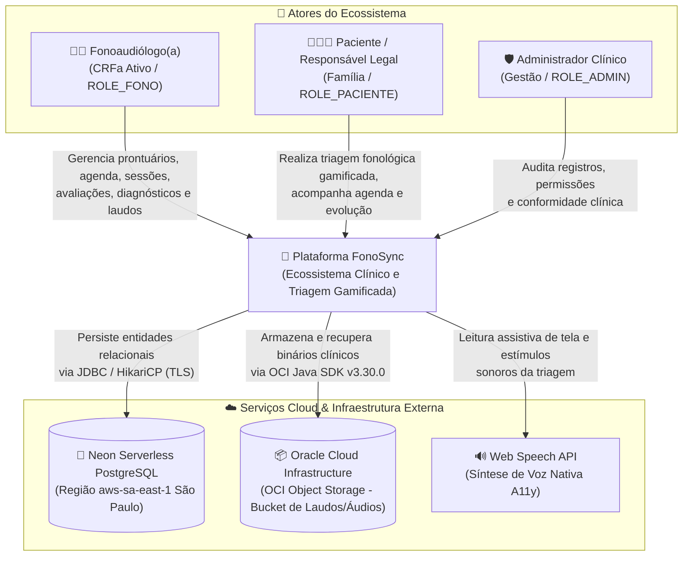
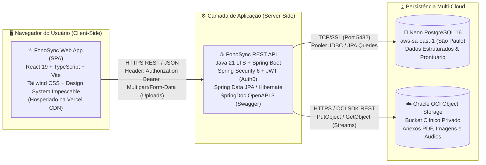
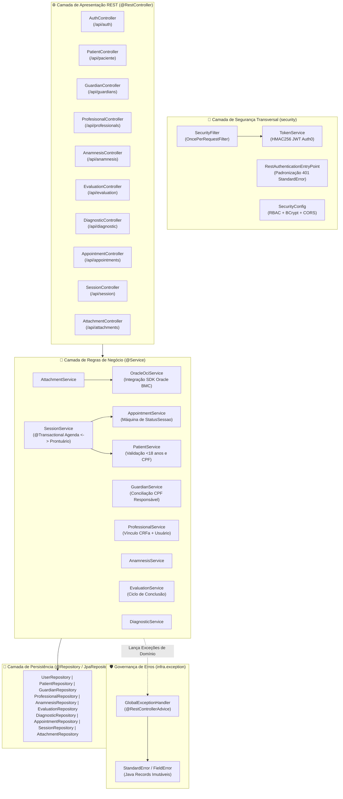
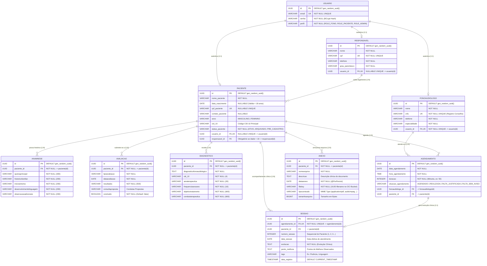
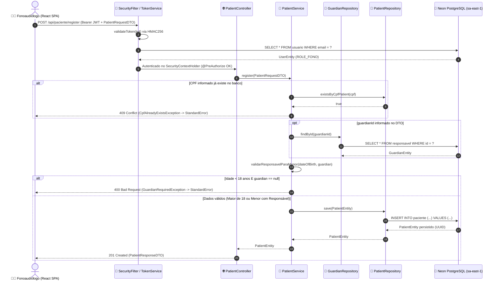

# 🏛️ System Design, Diagramas C4 e Modelagem de Dados (DER)

> [!NOTE] Navegação no Second Brain
> - **Índice Central:** [[00-FonoSync-Second-Brain-MOC|00 · MOC Índice Central]]
> - **Princípios de Engenharia:** [[01-Principios-SOLID-e-Padroes-de-Projeto|01 · Princípios SOLID e Padrões de Projeto]]
> - **Contratos REST & CRUD:** [[02-Catalogo-CRUD-Endpoints-e-Regras-de-Negocio|02 · Catálogo CRUD, Endpoints e GlobalExceptionHandler]]
> - **Infraestrutura & Segurança:** [[01-Cloud-Neon-OCI-Vercel-Seguranca-e-LGPD|01 · Multi-Cloud (Neon SP, OCI, Vercel), JWT, BCrypt e LGPD]]
> - **Arquitetura Frontend:** [[01-Arquitetura-Frontend-React-Rotas-Estado|01 · Arquitetura Frontend React 19]]

---

## 1. Visão Geral do Ecossistema FonoSync

### 1.1 O Problema Clínico: Fragmentação Terapêutica
Na prática fonoaudiológica tradicional — especialmente no acompanhamento do desenvolvimento infantil (transtornos fonológicos, atrasos de linguagem, fluência e motricidade orofacial) — existe um **abismo de continuidade entre três pilares essenciais**:
1. **O Consultório Clínico:** Onde o fonoaudiólogo realiza a anamnese, avaliações formais, diagnóstico (CID-10), planejamento terapêutico e sessões semanais de 50 minutos.
2. **A Família (Ambiente Doméstico):** Onde ocorre a maior parte da estimulação diária, mas que frequentemente carece de orientação estruturada, instrumentos lúdicos adequados à faixa etária e acesso transparente à evolução da criança.
3. **A Escola (Ambiente Educacional):** Onde os sinais precoces de dificuldades fonológicas, de leitura/escrita ou de socialização se manifestam primeiro, mas raramente são comunicados de forma técnica e estruturada ao terapeuta.

Sem uma plataforma unificada, os dados clínicos ficam dispersos em prontuários de papel, planilhas isoladas, áudios de WhatsApp e laudos em PDF perdidos, prejudicando a **intervenção precoce** e a **adesão familiar ao tratamento**.

### 1.2 A Solução Integrada: Consultório — Família — Escola
O **FonoSync** resolve essa fragmentação por meio de uma arquitetura web moderna, acessível e segura que conecta:
- **Triagem Fonológica Gamificada & Acolhedora:** Instrumentos interativos por faixa etária (`0–2 anos`, `2–4 anos`, `4–5 anos`, `6+ anos`) que auxiliam famílias e educadores a identificar sinais de alerta sem gerar ansiedade, encaminhando a criança ao especialista com dados estruturados de pré-cadastro (`PRE_CADASTRO`).
- **Prontuário Eletrônico Longitudinal (EHR Fonoaudiológico):** Gestão integrada de Pacientes (`PatientEntity`), Responsáveis Legais (`GuardianEntity`), Anamneses (`AnamnesisEntity`), Avaliações Clínicas (`EvaluationEntity`), Diagnósticos com CID-10 (`DiagnosticEntity`), Agenda (`AppointmentEntity`) e Evoluções de Sessão (`SessionEntity`).
- **Repositório Clínico em Nuvem (Cloud Object Storage):** Armazenamento seguro de exames, gravações de áudio de fala, relatórios escolares e laudos em PDF via **Oracle Cloud Infrastructure (OCI Object Storage)**.

---

## 2. Modelagem Arquitetural C4 (Contexto, Containers e Componentes)

A arquitetura do FonoSync foi documentada seguindo o modelo **C4 (Context, Containers, Components, Code)** de Simon Brown, garantindo rastreabilidade desde a visão de negócio até as classes Java do Spring Boot.

### 2.1 Nível 1 — Diagrama de Contexto do Sistema (C4 Context)



---

### 2.2 Nível 2 — Diagrama de Containers (C4 Container)



---

### 2.3 Nível 3 — Diagrama de Componentes do Backend (C4 Component)



---

## 3. Arquitetura em Camadas do Backend

O backend do FonoSync (`br.com.fonosync.fonosyncapi`) adota uma **Arquitetura em Camadas Estrita (Layered Architecture)** combinada com organização modular por domínio clínico (*Package by Feature/Domain*).

| Camada | Responsabilidade Arquitetural | Artefatos Reais no Projeto |
| :--- | :--- | :--- |
| **1. Security & Filter Chain** | Interceptação HTTP stateless, validação de assinatura JWT (`HMAC256`), injeção de `UserDetails` no `SecurityContextHolder` e proteção RBAC (`@PreAuthorize`). | `SecurityConfig`, `SecurityFilter`, `TokenService`, `RestAuthenticationEntryPoint` |
| **2. Presentation (Controllers)** | Exposição das rotas RESTful, desserialização JSON, validação sintática via Jakarta Bean Validation (`@Valid`) e mapeamento de códigos HTTP (`200`, `201`, `204`). | `PatientController`, `AuthController`, `SessionController`, `AttachmentController`, etc. |
| **3. DTOs (Data Transfer Objects)** | Contratos imutáveis de entrada e saída implementados com **Java 21 Records**, protegendo entidades de *Mass Assignment* e ocultando dados sensíveis. | `PatientRequestDTO`, `PatientResponseDTO`, `LoginRequestDTO`, `RegisterRequestDTO`, `TokenResponseDTO`, `StandardError` |
| **4. Business / Domain (Services)** | Aplicação de invariantes clínicas (ex: obrigatoriedade de responsável para menor de 18 anos, proibição de sessão em agendamento com falta, sincronização transacional `@Transactional`). | `PatientService`, `SessionService`, `EvaluationService`, `AttachmentService`, etc. |
| **5. Cloud Integration Adapter** | Encapsulamento do SDK externo da Oracle Cloud (`com.oracle.bmc.objectstorage`), convertendo `MultipartFile` em streams binários e traduzindo falhas de rede em `StorageException`. | `OracleOciService` |
| **6. Persistence (Repositories)** | Abstração de acesso a dados via Spring Data JPA (`JpaRepository<T, UUID>`), utilizando *Derived Query Methods* otimizados. | `PatientRepository`, `SessionRepository`, `GuardianRepository`, `UserRepository`, etc. |
| **7. Domain Entities (ORM)** | Mapeamento Objeto-Relacional (JPA/Hibernate) para o PostgreSQL, utilizando chaves primárias `UUID` geradas nativamente. | `UserEntity`, `PatientEntity`, `GuardianEntity`, `ProfessionalEntity`, `SessionEntity`, etc. |
| **8. Cross-Cutting Exception Handling** | Captura centralizada de qualquer exceção lançada pelas camadas inferiores, convertendo-as no contrato JSON padronizado `StandardError`. | `GlobalExceptionHandler` (`@RestControllerAdvice`) |

---

## 4. Modelagem do Banco de Dados Relacional (DER)

### 4.1 Estratégia de Identidade: Superclasse / Base `UserEntity` (`usuario`) e Perfis Especializados
No FonoSync, a autenticação e autorização são centralizadas na entidade base **`UserEntity`** (tabela `usuario`), que implementa `UserDetails` do Spring Security e define as credenciais (`email`, `senha` com hash BCrypt) e o perfil de acesso (`PerfilEnum`: `ROLE_FONO`, `ROLE_PACIENTE`, `ROLE_ADMIN`).

A partir de `UserEntity`, o domínio clínico especializa os papéis através de associação unidirecional/bidirecional `1:1` com chave estrangeira única (`usuario_id UNIQUE`), combinando a flexibilidade de composição relacional com a hierarquia lógica de usuários do sistema:
- **Fonoaudiólogo (`ProfessionalEntity` / `SpeechTherapistEntity` — tabela `fonoaudiologo`):** Possui vínculo obrigatório (`NOT NULL UNIQUE`) com `UserEntity`, adicionando o registro profissional único **`crfa`**, `nome`, `telefone` e `especialidade`.
- **Paciente (`PatientEntity` — tabela `paciente`):** Possui vínculo opcional (`UNIQUE`) com `UserEntity` (permitindo tanto pacientes pré-cadastrados na triagem quanto pacientes com login ativo) e vínculo `@ManyToOne` com **`GuardianEntity`** (`responsavel_id`), que é **estritamente obrigatório para pacientes menores de 18 anos**.
- **Responsável Legal (`GuardianEntity` — tabela `responsavel`):** Representa o pai, mãe ou tutor legal com `cpf` único, `grau_parentesco` e lista de dependentes (`List<PatientEntity> dependents`), também podendo vincular-se a um `UserEntity` para acesso ao Portal da Família.

### 4.2 Diagrama Entidade-Relacionamento (DER Completo em Mermaid)



> [!TIP] Prevenção de Loops Infinitos de Serialização e StackOverflowError
> Nas relações bidirecionais do JPA — como `GuardianEntity` $\leftrightarrow$ `PatientEntity` e `PatientEntity` $\leftrightarrow$ `AttachmentEntity` — o projeto utiliza explicitamente `@ToString.Exclude`, `@EqualsAndHashCode.Exclude` (do Lombok) e `@JsonIgnore` / `@JsonIgnoreProperties` (do Jackson) para evitar recursão infinita (`StackOverflowError`) durante logs ou serialização JSON.

---

## 5. Fluxos de Comunicação End-to-End (Frontend $\leftrightarrow$ Backend $\leftrightarrow$ Neon $\leftrightarrow$ OCI)

### 5.1 Fluxo 1: Autenticação Stateless e Cadastro de Paciente Menor de Idade
Este diagrama de sequência demonstra a validação de segurança (`SecurityFilter`) e a regra de negócio clínica que exige um `GuardianEntity` para pacientes menores de 18 anos.



---

### 5.2 Fluxo 2: Upload e Download Híbrido de Anexos Clínicos (Neon PostgreSQL + Oracle OCI)
Para manter o banco relacional leve e performático no Neon PostgreSQL, **nenhum binário (`BLOB`/`BYTEA`) é salvo no banco de dados**. O arquivo físico vai para o bucket da **Oracle Cloud (OCI)**, enquanto os metadados e a chave única (`fileKey`) são gravados na tabela `anexo`.

```mermaid
sequenceDiagram
    autonumber
    actor Fono as 👩‍⚕️ Fonoaudiólogo (React SPA)
    participant AttCtrl as 🌐 AttachmentController
    participant AttSvc as 🧠 AttachmentService
    participant OciSvc as ☁️ OracleOciService
    participant OCI as 📦 Oracle Cloud Object Storage
    participant Neon as 🐘 Neon PostgreSQL (sa-east-1)

    Note over Fono,Neon: ETAPA A: Upload de Laudo / Áudio Clínico (Multipart)
    Fono->>AttCtrl: POST /api/attachments/upload (patientId, file, description)
    AttCtrl->>AttSvc: uploadAttachment(patientId, file, description)
    AttSvc->>Neon: SELECT * FROM paciente WHERE id = patientId
    Neon-->>AttSvc: PatientEntity válido
    AttSvc->>OciSvc: uploadFile(MultipartFile)
    OciSvc->>OciSvc: Gera fileKey = UUID.randomUUID() + "-" + originalFilename
    OciSvc->>OCI: PutObjectRequest (InputStream, Content-Type, Content-Length)
    
    alt Falha de Rede ou Permissão OCI
        OCI-->>OciSvc: BMC Exception
        OciSvc-->>Fono: 502 Bad Gateway (StorageException -> GlobalExceptionHandler)
    else Upload OCI Concluído
        OCI-->>OciSvc: 200 OK (Object Stored)
        OciSvc-->>AttSvc: Retorna fileKey
        AttSvc->>Neon: INSERT INTO anexo (paciente_id, nomearquivo, filekey, tipoconteudo, tamanhoarquivo, dataanexo)
        Neon-->>AttSvc: AttachmentEntity salvo
        AttSvc-->>AttCtrl: AttachmentEntity
        AttCtrl-->>Fono: 201 Created (JSON Metadados do Anexo)
    end

    Note over Fono,Neon: ETAPA B: Visualização Inline / Download do Anexo
    Fono->>AttCtrl: GET /api/attachments/{id}/download
    AttCtrl->>AttSvc: findById(id)
    AttSvc->>Neon: SELECT * FROM anexo WHERE id = ?
    Neon-->>AttSvc: AttachmentEntity (contendo fileKey e contentType)
    AttCtrl->>AttSvc: getAttachmentFile(attachment.getFileKey())
    AttSvc->>OciSvc: downloadFile(fileKey)
    OciSvc->>OCI: GetObjectRequest (namespace, bucket, fileKey)
    OCI-->>OciSvc: GetObjectResponse (InputStream -> byte[])
    OciSvc-->>AttCtrl: byte[] fileBytes
    AttCtrl-->>Fono: 200 OK (Content-Disposition: inline; Content-Type: original)
```
