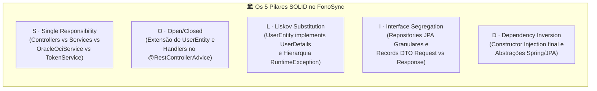
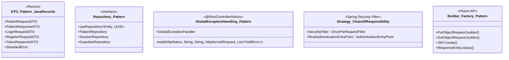

# 🧱 Princípios SOLID e Padrões de Projeto no FonoSync

> [!NOTE] Navegação no Second Brain
> - **Índice Central:** [[00-FonoSync-Second-Brain-MOC|00 · MOC Índice Central]]
> - **Arquitetura & DER:** [[01-System-Design-e-Arquitetura-Geral|01 · System Design, Diagramas C4 e DER]]
> - **Catálogo CRUD & Endpoints:** [[02-Catalogo-CRUD-Endpoints-e-Regras-de-Negocio|02 · Catálogo CRUD, Endpoints e GlobalExceptionHandler]]
> - **Infraestrutura & Segurança:** [[01-Cloud-Neon-OCI-Vercel-Seguranca-e-LGPD|01 · Multi-Cloud (Neon SP, OCI, Vercel), JWT, BCrypt e LGPD]]

---

## 1. Visão Geral da Engenharia de Software no Backend

A API RESTful do **FonoSync** (`c:\Users\danie\IdeaProjects\fonosync-api`) foi construída em **Java 21 LTS** com **Spring Boot**, aplicando rigorosamente os 5 princípios **SOLID** (Robert C. Martin) e padrões de projeto consagrados (*GoF* e *Enterprise Application Architecture*). Essa disciplina arquitetural garante baixo acoplamento, alta coesão, facilidade de manutenção evolutiva e tratamento determinístico de falhas.



---

## 2. Aplicação Prática dos 5 Princípios SOLID no Código Real

### 2.1 `[S]` — Single Responsibility Principle (Princípio da Responsabilidade Única)
> *"Uma classe deve ter um, e apenas um, motivo para mudar."*

No FonoSync, nenhuma classe acumula responsabilidades mistas (como tratar HTTP, validar regra clínica, acessar banco SQL e enviar arquivos para a nuvem no mesmo arquivo). Cada responsabilidade possui sua própria unidade coesa:

| Classe Real no Projeto | Única Responsabilidade (Motivo para Mudar) |
| :--- | :--- |
| `PatientController` / `AttachmentController` | **Roteamento HTTP e Contrato REST:** Receber requisições HTTP, validar anotações `@Valid`, invocar o Service correspondente e devolver `ResponseEntity` com o código HTTP apropriado (`200`, `201`, `204`). |
| `PatientService` / `SessionService` | **Regras de Negócio Clínicas:** Validar maioridade (`validarResponsavelParaMenor`), impedir duplicidade de CPF, sincronizar status de agendamento (`StatusSessao.REALIZADA`) e coordenar transações (`@Transactional`). |
| `PatientRepository` / `SessionRepository` | **Persistência Relacional (JPA):** Declarar consultas derivadas e operações CRUD no PostgreSQL sem conter lógica de negócio. |
| `OracleOciService` | **Infraestrutura de Storage em Nuvem:** Lidar exclusivamente com a autenticação do SDK da Oracle Cloud (`ConfigFileAuthenticationDetailsProvider`) e streams `PutObjectRequest` / `GetObjectRequest`. |
| `TokenService` | **Criptografia e Ciclo de Vida JWT:** Assinar (`HMAC256`) e verificar tokens JWT com `com.auth0.jwt`. |
| `GlobalExceptionHandler` | **Tradução de Exceções para HTTP:** Interceptar exceções lançadas em qualquer ponto da aplicação e formatá-las no record `StandardError`. |

#### Exemplo Real de Separação SRP: `AttachmentService` vs `OracleOciService`
O `AttachmentService` orquestra o vínculo clínico entre paciente e metadados do documento, delegando 100% da comunicação com a nuvem da Oracle para o `OracleOciService`:

```java
// AttachmentService.java — Responsabilidade: Regra de vínculo clínico e persistência de metadados
public AttachmentEntity uploadAttachment(UUID patientId, MultipartFile file, String description) {
    PatientEntity patient = patientRepository.findById(patientId)
            .orElseThrow(() -> new PatientNotFoundException("Erro: Paciente não encontrado."));

    // Delega a responsabilidade de armazenamento binário na nuvem ao especialista (SRP)
    String fileKey = oracleOciService.uploadFile(file);

    AttachmentEntity attachment = new AttachmentEntity();
    attachment.setPatient(patient);
    attachment.setFileName(file.getOriginalFilename());
    attachment.setDescription(description);
    attachment.setContentType(file.getContentType());
    attachment.setFileSize(file.getSize());
    attachment.setFileKey(fileKey);

    return attachmentRepository.save(attachment);
}
```

---

### 2.2 `[O]` — Open/Closed Principle (Princípio Aberto/Fechado)
> *"Entidades de software devem estar abertas para extensão, mas fechadas para modificação."*

O princípio **OCP** é aplicado em duas frentes estruturais do FonoSync:

#### A. Extensão de Perfis a partir de `UserEntity` (`usuario`)
O núcleo de autenticação (`SecurityFilter`, `TokenService`, `AuthController`) opera exclusivamente sobre a entidade base `UserEntity` e o enumerador `PerfilEnum` (`ROLE_FONO`, `ROLE_PACIENTE`, `ROLE_ADMIN`).
- Quando novos perfis especializados de domínio são adicionados ou estendidos — como **`ProfessionalEntity`** (`SpeechTherapistEntity` com registro `crfa` e `specialty`), **`PatientEntity`** (com `cid10`, `dateOfBirth` e `patientStatus`) ou **`GuardianEntity`** (com `cpf` e `relationship`) — o mecanismo de login, geração de token JWT e filtro de segurança **não precisa ser modificado**.

#### B. Arquitetura Extensível de Exceções no `GlobalExceptionHandler`
O `GlobalExceptionHandler` (`@RestControllerAdvice`) utiliza um método construtor interno padronizado (`build(...)`) e métodos anotados com `@ExceptionHandler`. Para suportar uma nova exceção de domínio clínico no futuro, basta criar a nova classe de exceção e adicionar um método `@ExceptionHandler` dedicado, **sem alterar o código de nenhum Controller ou dos handlers já existentes**:

```java
// GlobalExceptionHandler.java — Aberto para novos handlers sem modificar os fluxos existentes
@ExceptionHandler(GuardianRequiredException.class)
public ResponseEntity<StandardError> handleGuardianRequired(GuardianRequiredException ex, HttpServletRequest request) {
    return build(HttpStatus.BAD_REQUEST, "Responsável Obrigatório", ex.getMessage(), request, null);
}

@ExceptionHandler(BusinessRuleException.class)
public ResponseEntity<StandardError> handleBusinessRule(BusinessRuleException ex, HttpServletRequest request) {
    return build(HttpStatus.UNPROCESSABLE_ENTITY, "Regra de Negócio Violada", ex.getMessage(), request, null);
}
```

---

### 2.3 `[L]` — Liskov Substitution Principle (Princípio da Substituição de Liskov)
> *"Objetos de uma superclasse ou interface devem poder ser substituídos por objetos de suas subclasses/implementações sem quebrar a integridade do programa."*

#### A. Polimorfismo em `UserEntity implements UserDetails`
O Spring Security trabalha com o contrato abstrato `org.springframework.security.core.userdetails.UserDetails`. A classe `UserEntity` implementa integralmente esse contrato:

```java
// UserEntity.java — Substituível em qualquer ponto do Spring Security que espere UserDetails
public class UserEntity implements UserDetails {
    // ...
    @Override
    public Collection<? extends GrantedAuthority> getAuthorities() {
        return List.of(new SimpleGrantedAuthority(this.role.name()));
    }

    @Override
    public String getUsername() {
        return this.email;
    }
}
```
Graças ao **LSP**, tanto o `UsernamePasswordAuthenticationToken` no `SecurityFilter` quanto a anotação `@AuthenticationPrincipal UserEntity currentUser` no `ProfesisonalController` operam de maneira transparente e polimórfica para qualquer tipo de usuário autenticado (`ROLE_FONO`, `ROLE_PACIENTE` ou `ROLE_ADMIN`).

#### B. Hierarquia Consistente de Exceções de Domínio (`RuntimeException`)
Todas as exceções customizadas do sistema (`GuardianRequiredException`, `CpfAlreadyExistsException`, `PatientNotFoundException`, `ResourceNotFoundException`, `ConflictException`, `BusinessRuleException`, `StorageException`) herdam de `RuntimeException` mantendo o contrato semântico da superclasse (`getMessage()`, `getCause()`) e permitindo rollback transacional automático pelo `@Transactional` do Spring em caso de falha.

---

### 2.4 `[I]` — Interface Segregation Principle (Princípio da Segregação de Interfaces)
> *"Nenhum cliente deve ser forçado a depender de métodos ou contratos que não utiliza."*

#### A. Interfaces Granulares de Repositório por Agregado
Em vez de um repositório monolítico genérico ("God Repository"), o FonoSync segrega a persistência em **10 interfaces enxutas e específicas por domínio**, expondo apenas as queries pertinentes àquele módulo:

- `PatientRepository`: Expõe `existsByCpfPatient(String)` e `existsByCpfPatientAndIdNot(String, UUID)`.
- `GuardianRepository`: Expõe `findByCpf(String)` para conciliação rápida de responsáveis.
- `ProfessionalRepository`: Expõe `findByUsuario(UserEntity)` e `findByCrfa(String)`.
- `SessionRepository`: Expõe `findByAgendamentoId(UUID)`, `existsByAgendamentoId(UUID)` e `findByPacienteIdOrderByNumeroSessaoDescDataRegistroDesc(UUID)`.
- `UserRepository`: Expõe `findByEmail(String)` e `existsByEmail(String)`.
- `AnamnesisRepository`, `EvaluationRepository`, `DiagnosticRepository`, `AttachmentRepository`: Expõem consultas filtradas por paciente.

#### B. Segregação de Contratos DTO (Request vs Response)
Os endpoints de autenticação e pacientes não expõem a entidade interna de banco nem forçam o cliente a enviar campos de leitura:
- `LoginRequestDTO(email, password)`: Contém apenas as 2 propriedades necessárias para autenticação.
- `RegisterRequestDTO(email, password, role)`: Contém apenas os 3 campos para criação de conta.
- `TokenResponseDTO(token, email, role)`: Devolve a sessão autenticada **sem jamais expor o hash da senha**.
- `PatientRequestDTO` vs `PatientResponseDTO`: Separa o payload de entrada (com validações `@NotBlank`, `@PastOrPresent`) do payload de saída (que inclui o `UUID id` gerado).

---

### 2.5 `[D]` — Dependency Inversion Principle (Princípio da Inversão de Dependência)
> *"Módulos de alto nível não devem depender de módulos de baixo nível. Ambos devem depender de abstrações."*

1. **Injeção de Dependência via Construtor com Campos `final` Imutáveis:**
   Em **100% dos Controllers, Services e Filters** do FonoSync, não se utiliza `@Autowired` diretamente em atributos privados (*Field Injection*, considerada má prática). Todas as dependências são declaradas como `private final` e injetadas via **Construtor**, garantindo imutabilidade, segurança em ambientes multi-thread e facilidade para injeção de *Mocks* em testes unitários:

```java
// SessionService.java — Injeção via construtor com dependências final imutáveis
@Service
public class SessionService {

    private final SessionRepository sessionRepository;
    private final AppointmentService appointmentService;
    private final PatientService patientService;

    public SessionService(SessionRepository sessionRepository,
                          AppointmentService appointmentService,
                          PatientService patientService) {
        this.sessionRepository = sessionRepository;
        this.appointmentService = appointmentService;
        this.patientService = patientService;
    }
    // ...
}
```

2. **Acoplamento a Abstrações (`PasswordEncoder`, `JpaRepository`, `ObjectStorage`):**
   - O `AuthController` não depende diretamente da implementação concreta `BCryptPasswordEncoder`; ele depende da interface `org.springframework.security.crypto.password.PasswordEncoder` injetada pelo bean configurado em `SecurityConfig`.
   - Os Services dependem das interfaces `JpaRepository` em vez de implementações concretas do driver JDBC do PostgreSQL.
   - O `OracleOciService` referencia a interface `com.oracle.bmc.objectstorage.ObjectStorage` e a abstração `AuthenticationDetailsProvider`.

---

## 3. Catálogo de Padrões de Projeto (Design Patterns) Aplicados



### 3.1 DTO Pattern com Java 21 `record`
O FonoSync utiliza `record` nativo do Java 21 para todos os objetos de transferência de dados (`PatientRequestDTO`, `PatientResponseDTO`, `LoginRequestDTO`, `RegisterRequestDTO`, `TokenResponseDTO`, `StandardError` e `StandardError.FieldError`).
- **Vantagens Técnicas:** Imutabilidade total por padrão (`final`), geração automática de construtor canônico, `equals()`, `hashCode()`, `toString()` e *accessors* sem verbo (`dto.name()`, `dto.dateOfBirth()`), eliminando *boilerplate* e prevenindo mutações acidentais de estado durante o ciclo da requisição.
- **Mapper Construtor Compacto:** O `PatientResponseDTO` implementa um construtor secundário limpo que converte `PatientEntity` em DTO extraindo com segurança `entity.getGuardian() != null ? entity.getGuardian().getId() : null`.

### 3.2 Repository Pattern (Spring Data JPA)
Abstrai a camada de dados simulando uma coleção em memória de objetos de domínio. As consultas SQL são sintetizadas automaticamente pela árvore de métodos (*Query Method DSL*), como:
- `findByPacienteIdOrderByNumeroSessaoDescDataRegistroDesc(UUID patientId)` em `SessionRepository`, que gera a query ordenada do histórico longitudinal de sessões do paciente sem necessidade de escrever SQL nativo propenso a erros.

### 3.3 Global Exception Handling / AOP Interceptor (`@RestControllerAdvice`)
Baseado em **Programação Orientada a Aspectos (AOP)**, o `GlobalExceptionHandler` intercepta transversalmente qualquer falha lançada pelos 10 módulos da API e a transforma no record imutável `StandardError`:

```java
public record StandardError(
        LocalDateTime timestamp,
        Integer status,
        String error,
        String message,
        String path,
        List<FieldError> fieldErrors
) {
    public record FieldError(String field, String message) {}
}
```
Isso garante que o Frontend React 19 nunca receba páginas HTML de erro ou *Stack Traces* internos do Java, mantendo um contrato JSON previsível em 100% dos cenários de erro (`400` a `502`).

### 3.4 Chain of Responsibility & Strategy Pattern (Spring Security Filter Chain)
- **Chain of Responsibility:** O `SecurityFilter` estende `OncePerRequestFilter` e insere-se na cadeia de filtros antes do `UsernamePasswordAuthenticationFilter`. O método `shouldNotFilter(HttpServletRequest)` otimiza a performance pulando a validação JWT em rotas públicas (`/api/auth/**`, `/swagger-ui/**`, `/v3/api-docs/**`).
- **Strategy Pattern:** A política de codificação de senhas (`PasswordEncoder` $\rightarrow$ `BCryptPasswordEncoder`) e a estratégia de tratamento de acessos não autenticados (`AuthenticationEntryPoint` $\rightarrow$ `RestAuthenticationEntryPoint`) são injetadas como estratégias plugáveis no `SecurityConfig`.

### 3.5 Builder Pattern
Utilizado extensivamente na construção fluente de objetos complexos de infraestrutura:
- **Oracle OCI SDK:** `ObjectStorageClient.builder().build(provider)`, `PutObjectRequest.builder().namespaceName(...).bucketName(...).objectName(...).build()`.
- **Auth0 JWT:** `JWT.create().withIssuer("fonosync-api").withSubject(...).withClaim(...).sign(algorithm)`.
- **OpenAPI 3 (Swagger):** Configuração fluente do esquema `bearer-key` em `OpenApiConfig`.
