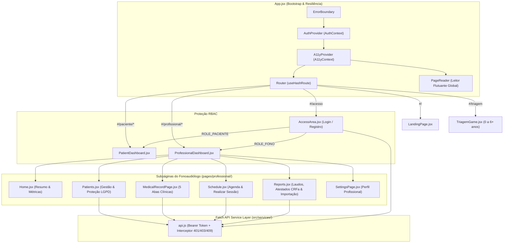

# Arquitetura Frontend — React 19, Rotas, Estado e Fluxos Clínicos

> [!NOTE] Visão Geral da Arquitetura SPA
> O frontend do **FonoSync** é construído como uma Single Page Application (SPA) modular, enxuta e resiliente sobre **React 19** + **Vite 8** + **Tailwind CSS v4**. A aplicação foi projetada para eliminar dependências supérfluas, operando com roteamento baseado em hash (`useHashRoute`), camada própria de comunicação HTTP (`services/api.js`) com interceptação automática de sessão expirada e dois provedores globais de estado (`AuthContext` e `A11yContext`).

Conexões diretas no Segundo Cérebro:
- [[02-Design-System-Impeccable-Tokens-e-Tipografia|Design System Impeccable, Tokens e Tipografia]]
- [[03-Acessibilidade-IHC-e-Modulo-Triagem-Fonologica|Acessibilidade IHC e Módulo de Triagem Fonológica]]
- [[01-Visao-Geral-e-Proposito-Clinico|Visão Geral e Propósito Clínico]]
- [[02-Seguranca-Spring-Security-JWT-OAuth2-RBAC|Segurança Backend JWT, OAuth2 e RBAC]]

---

## 1. Stack Tecnológica Completa

A escolha da stack prioriza velocidade de compilação, zero overhead de runtime CSS-in-JS, tipografia editorial de alta legibilidade e acessibilidade nativa no navegador.

| Camada | Tecnologia / Pacote | Versão | Papel Arquitetural no FonoSync |
| :--- | :--- | :--- | :--- |
| **Core UI Library** | `react` & `react-dom` | `^19.2.8` | Renderização declarativa, hooks concorrentes, Portals (`createPortal` para modais A11y) e `ErrorBoundary`. |
| **Build Tool & Bundler** | `vite` & `@vitejs/plugin-react` | `^8.3.0` | Servidor de desenvolvimento ultrarrápido com HMR e empacotamento ESM otimizado para produção. |
| **Estilização & Tokens** | `tailwindcss` & `@tailwindcss/vite` | `^4.3.3` | Motor CSS-first via diretiva `@theme` em `src/index.css`, variáveis CSS dinâmicas e `color-mix(in oklab, ...)`. |
| **Iconografia Clínica** | `lucide-react` | `^1.55.0` | Ícones vetoriais acessíveis (`aria-hidden="true"`, traço consistente) para ações clínicas, áudio e navegação. |
| **Autenticação Social** | `@react-oauth/google` & `jwt-decode` | `^0.13.5` / `^4.0.0` | Integração OAuth 2.0 com Google Identity Services e decodificação de claims JWT no cliente. |
| **Comunicação HTTP** | Fetch API Service Layer (`src/services/api.js`) | Nativa (ES2024+) | Cliente REST centralizado com injeção de `Bearer Token`, tratamento de HTTP `204/401/403/409` e eventos globais de sessão. |
| **Qualidade de Código** | `eslint`, `eslint-plugin-react-hooks` | `^10.10.0` | Verificação estática de regras de Hooks e atualização rápida de componentes. |

---

## 2. Arquitetura de Pastas e Organização Modular

O código-fonte reside em `src/` e segue uma separação estrita por responsabilidade técnica e domínio clínico:

```text
src/
├── App.jsx                         # Ponto de montagem: ErrorBoundary > AuthProvider > A11yProvider > Router + PageReader
├── main.jsx                        # Bootstrap do React 19 DOM Root e GoogleOAuthProvider
├── index.css                       # Tokens @theme do Tailwind v4, modos de contraste, daltonismo e ::highlight
├── assets/
│   └── images/
│       ├── ModeloA_Semnome.jpg     # Identidade visual institucional FonoSync
│       └── care/                   # Direção de fotografia real de cuidado fonoaudiológico (9 ativos curados)
├── components/                     # Componentes de UI reutilizáveis, acessibilidade e módulo de triagem
│   ├── A11yModal.jsx               # Portal DOM (document.body) para isolar o painel de backdrop-blur
│   ├── About.jsx                   # Prévia interativa dos painéis clínico e familiar na Landing Page
│   ├── AccessibilityPanel.jsx      # Controle completo de voz, fonte, contraste, daltonismo, leading e tracking
│   ├── AudioModal.jsx              # Modal para interação sonora e gravação/orientação
│   ├── Button.jsx                  # Wrapper semântico de botão consumindo buttonStyles.js
│   ├── buttonStyles.js             # Variantes oficiais de botão (primary, secondary, tertiary, danger)
│   ├── DataTable.jsx               # Tabela responsiva de dados clínicos
│   ├── Footer.jsx                  # Rodapé editorial com links de pesquisa, LGPD e ética fonoaudiológica
│   ├── Header.jsx                  # Cabeçalho sticky com atalhos diretos para Acessibilidade e Ouvir Página
│   ├── InfoDialog.jsx              # Diálogo modal informativo (Pesquisa Clínica & Privacidade LGPD)
│   ├── Notice.jsx                  # Alertas contextuais semânticos (success, warning, danger, info)
│   ├── PageReader.jsx              # Player flutuante fixo para leitura sintetizada da página
│   ├── Switch.jsx                  # Controle booleano acessível com role="switch"
│   └── TriagemGame.jsx             # Módulo completo de Rastreio Fonoaudiológico Precoce (0 a 6+ anos)
├── context/                        # Provedores de estado global
│   ├── A11yContext.jsx             # Estado de acessibilidade visual, motora e síntese de voz (Web Speech API)
│   └── AuthContext.jsx             # Estado de sessão autenticada, login, registro e logout
├── hooks/                          # Custom Hooks de consumo de contexto e navegação
│   ├── useA11y.js                  # Acesso tipado ao A11yContext
│   ├── useAuth.js                  # Acesso tipado ao AuthContext
│   └── useHashRoute.js             # Escuta reativa de window.location.hash (evento hashchange)
├── pages/                          # Páginas de topo e subpáginas do domínio clínico
│   ├── LandingPage.jsx             # Página editorial pública com Bento Grid e Percursos de Cuidado
│   ├── AccessArea.jsx              # Portal unificado de Login e Cadastro por perfil (Fono, Responsável, Adulto)
│   ├── PatientDashboard.jsx        # Ambiente autenticado do Paciente e Família
│   ├── ProfessionalDashboard.jsx   # Shell autenticado do Fonoaudiólogo com menu lateral e roteamento interno
│   └── professional/               # Subpáginas do consultório digital
│       ├── Home.jsx                # Resumo executivo, indicadores ativos e avaliações em aberto
│       ├── Patients.jsx            # Gestão de pacientes, filtros, proteção de menores (LGPD) e status
│       ├── MedicalRecordPage.jsx   # Prontuário completo em 5 abas (Histórico, Avaliações, Diagnóstico, Anamnese, Anexos)
│       ├── Schedule.jsx            # Agenda cronológica (Hoje, Semana, Lista) e conversão de consulta em sessão
│       ├── Reports.jsx             # Emissão de laudos PDF, relatórios interdisciplinares, atestados CRFa e importação
│       └── SettingsPage.jsx        # Configurações profissionais do fonoaudiólogo e consultório
├── services/                       # Camada de integração com a API REST Spring Boot
│   ├── api.js                      # Wrapper Fetch central, gestão de token no localStorage e erro 401/403/409
│   ├── authService.js              # Login, registro, atualização de sessão e resolução de rota inicial (homeFor)
│   ├── patientService.js           # CRUD de pacientes, arquivamento (/archive) e criação de responsável
│   ├── guardianService.js          # Consulta e listagem de responsáveis legais (/api/guardians)
│   ├── professionalService.js      # Registro e listagem de fonoaudiólogos (/api/professionals)
│   ├── anamnesisService.js         # CRUD de anamnese clínica vinculada ao paciente
│   ├── diagnosticService.js        # CRUD de diagnóstico fonoaudiológico, CID-10 e plano terapêutico
│   ├── evaluationService.js        # CRUD de avaliações clínicas especializadas
│   ├── attachmentService.js        # Upload multipart/form-data e download de exames/anexos
│   └── recordService.js            # Agregador de chamadas de prontuário e conclusão de avaliações
└── utils/                          # Utilitários puros e algoritmos de DOM
    ├── constants.js                # Chaves de storage, limites de fonte/voz, paletas de daltonismo e textos LGPD
    ├── formatters.js               # Formatação de CPF, telefone, data BR, cálculo exato de idade e bytes
    └── readingHighlight.js         # TreeWalker DOM, segmentação de frases e CSS Custom Highlight API
```

---

## 3. Sistema de Roteamento, Proteção por Role (RBAC) e ErrorBoundary

### 3.1. Roteador Reativo Baseado em Hash (`useHashRoute`)
O FonoSync utiliza um roteador leve baseado em hash (`#/rota`) implementado em `src/hooks/useHashRoute.js`. Essa abordagem garante compatibilidade imediata com qualquer servidor estático ou container sem exigir regras complexas de rewrite, além de disparar o evento nativo `hashchange` — que também é escutado pelo `A11yContext` para interromper automaticamente leituras de voz ao trocar de tela.

```javascript
// src/hooks/useHashRoute.js
function readRoute() {
  const hash = window.location.hash.slice(1);
  return hash.startsWith('/') ? hash : '/';
}
```

### 3.2. Proteção de Rotas por Perfil (`ROLE_FONO` / `ROLE_FONOAUDIOLOGO` vs `ROLE_PACIENTE`)
O componente `Router` dentro de `src/App.jsx` inspeciona a rota atual e o `session?.role` proveniente do `AuthContext`, aplicando redirecionamentos imediatos via `window.location.replace(to)`:

| Padrão de Rota (Hash) | Componente Renderizado | Regra de Acesso e Proteção RBAC |
| :--- | :--- | :--- |
| `#/` (ou rota vazia/desconhecida) | `LandingPage` | **Pública.** Acessível a qualquer visitante. |
| `#/triagem` | `TriagemGame` | **Pública (Minimização de Dados LGPD).** Permite que famílias e educadores realizem o rastreio sem barreira de login. |
| `#/acesso` | `AccessArea` | **Pública.** Login e cadastro segmentado em 3 perfis clínicos. |
| `#/profissional/:section?/:recordId?` | `ProfessionalDashboard` | **Protegida (Fonoaudiólogo).** Se `!role`, redireciona para `#/acesso`. Se `role === 'ROLE_PACIENTE'`, redireciona para `#/paciente/inicio`. Extrai `section` (`dashboard`, `pacientes`, `prontuario`, `agenda`, `relatorios`, `configuracoes`) e `recordId`. |
| `#/paciente/:tab?` | `PatientDashboard` | **Protegida (Paciente/Família).** Se `!role`, redireciona para `#/acesso`. Se `role !== 'ROLE_PACIENTE'`, redireciona para `#/profissional/dashboard`. |

> [!IMPORTANT] Harmonização de Roles com o Backend
> A função `homeFor(role)` em `src/services/authService.js` define que `role === 'ROLE_PACIENTE'` direciona para `#/paciente/inicio`, enquanto perfis profissionais (`ROLE_FONO` ou `ROLE_FONOAUDIOLOGO`) são direcionados para `#/profissional/dashboard`.

### 3.3. Resiliência com `ErrorBoundary`
No topo da árvore de componentes em `src/App.jsx`, a classe `ErrorBoundary` envolve `AuthProvider`, `A11yProvider`, `Router` e `PageReader`. Caso ocorra qualquer exceção de renderização inesperada, a aplicação não exibe tela branca: apresenta um painel de diagnóstico claro com a stack da exceção e um botão de recuperação imediata (`Recarregar Página`).

---

## 4. Gerenciamento de Estado, Persistência e Camada de Serviços REST

### 4.1. `AuthContext` e Ciclo de Vida da Sessão (`fonosync:sessao`)
O `AuthContext` (`src/context/AuthContext.jsx`) mantém o estado reativo da sessão do usuário, sincronizando-o com o `localStorage` sob a chave `fonosync:sessao`.

- **Injeção Automática de JWT:** Em `src/services/api.js`, toda requisição verifica `getSession()?.token` e anexa o cabeçalho `Authorization: Bearer <token>`.
- **Expiração e Revogação Reativa:** Se o backend retornar HTTP `401 Unauthorized` ou `403 Forbidden` sem mensagem específica de negócio em rotas autenticadas, `api.js` executa `clearSession()`, dispara o evento global `window.dispatchEvent(new Event('fonosync:sessao-encerrada'))` e redireciona para `#/acesso`. O `AuthProvider` escuta esse evento e limpa o estado `session` em memória imediatamente.
- **Tratamento Semântico de Erros Clínicos:**
  - `403 Forbidden`: Informa claramente falta de permissão de fonoaudiólogo ou expiração.
  - `409 Conflict`: Informa conflito de integridade cadastral (ex.: CPF ou e-mail já registrado).
  - `fieldErrors`: Extrai mensagens de validação campo a campo enviadas pelo Spring Boot.

### 4.2. Chaves de Persistência Local (`localStorage`)

| Chave no `localStorage` | Módulo Responsável | Finalidade e Ciclo de Vida |
| :--- | :--- | :--- |
| `fonosync:sessao` | `services/api.js` & `AuthContext` | Armazena token JWT, `role`, `name`, `email`, `crfa` e metadados do usuário autenticado. Limpo no logout ou erro 401. |
| `fonosync:acessibilidade` | `context/A11yContext.jsx` | Persiste preferências visuais e de voz (`fontPercent`, `highContrast`, `darkMode`, `reduceMotion`, `largeTargets`, `colorMode`, `textColor`, `buttonColor`, `leading`, `tracking`, `voiceGender`, `speechRate`). |
| `fonosync:triagem_history` | `components/TriagemGame.jsx` | Mantém o histórico local de sessões de rastreio realizadas no navegador para comparação e download de relatório `.txt`. |
| `fonosync:sessions:${patientId}` | `pages/professional/MedicalRecordPage.jsx` | Armazena a linha do tempo de evoluções de sessões clínicas por paciente para resposta imediata na interface. |

---

## 5. Fluxos Detalhados das Páginas da Aplicação

### 5.1. `LandingPage.jsx` — Apresentação Editorial e Cuidado Integrado
Estruturada em 7 seções editoriais que comunicam a proposta de valor sem jargões artificiais:
1. **Hero Editorial Claro:** Tipografia `Fraunces`, CTA direto para `#/triagem` e `#sobre`, pilares factuais (`0 a 6+ anos`, `Prontuário & Agenda`, `Leitura & A11y`) e fotografia real de atendimento familiar.
2. **Bento Grid Assimétrico de Prática Clínica:** 4 blocos visuais cobrindo *Observação Articulatória e Fonológica*, *Consciência Fonológica*, *Engajamento Lúdico (5 rodadas)* e *Vínculo e Evolução*.
3. **Percursos de Cuidado por Perfil (`role="tablist"`):** Seletor interativo com 4 jornadas: `01. Famílias e Crianças`, `02. Fonoaudiólogos e Clínicas`, `03. Escolas e Educadores` e `04. Instituições e Redes de Cuidado`.
4. **Módulo de Rastreio por Faixa Etária:** Cards detalhando as 4 etapas do desenvolvimento infantil.
5. **Prévia Interativa (`About.jsx`):** Demonstração funcional dos recursos da plataforma.
6. **Compromisso Clínico e Acessibilidade:** Três diretrizes éticas (Rastreio não substitui diagnóstico CRFa, Acessibilidade em primeiro plano e Proteção LGPD de menores).
7. **CTA Editorial Final:** Chamada em fundo `--color-navy` para início imediato da triagem ou login.

### 5.2. `AccessArea.jsx` — Autenticação e Cadastro com Regras Clínicas
Centraliza a entrada na plataforma com suporte a **Login por E-mail/Senha**, **Google OAuth 2.0** (com fallback inteligente para modo de demonstração caso o diálogo seja fechado ou o backend esteja offline) e **Cadastro em 3 Categorias Clínicas**:
1. **Fonoaudiólogo (`ROLE_FONO`):** Exige Nome Completo, Registro **CRFa**, Telefone/WhatsApp, Especialidade (Clínica Geral, Linguagem Infantil, Audiologia, Motricidade Orofacial, Voz, Educacional), E-mail e Senha. Executa `register()` seguido de `registerProfessional()`.
2. **Responsável Legal de Menor (`ROLE_PACIENTE`):** Valida a idade da criança (`calculateAge(patientBirthDate) < 18`). Registra primeiro o usuário autenticável, depois cria o responsável via `createGuardian()` (com CPF obrigatório do adulto) e finalmente cria a criança via `createPatient()` com `cpfPatient: null` e status `PRE_CADASTRO`, protegendo os dados do menor conforme a LGPD.
3. **Paciente Adulto (`ROLE_PACIENTE`):** Valida maioridade (`age >= 18`), exige CPF próprio, cria a conta autenticável e o registro de paciente com `guardianId: null`.

### 5.3. `ProfessionalDashboard.jsx` e Subpáginas do Consultório
Funciona como o *App Shell* do fonoaudiólogo, com menu lateral responsivo (`bg-band`), atalhos de acessibilidade/voz, identificação com iniciais do profissional e contador em tempo real de **Pacientes Ativos**. Gerencia 6 subpáginas:
- **`Home.jsx` (Início/Dashboard):** Exibe 4 indicadores (`Em acompanhamento`, `Pré-cadastro`, `Avaliações em andamento`, `Prontuários arquivados`), lista os 5 pacientes mais recentes com link direto para o prontuário e destaca avaliações não concluídas.
- **`Patients.jsx` (Gestão de Pacientes):** Listagem em tabela (Desktop) ou cards (Mobile), busca textual por nome/telefone, filtro por faixa etária e abas por status (`Todos Ativos`, `Em acompanhamento`, `Pré-cadastro`, `Ver Arquivados`). Inclui modal de cadastro/edição com `datalist` de sugestões **CID-10** (`F80.0`, `F80.1`, `F80.2`, `F98.5`, `R47.0`, `R49.0`, `H90`) e bloqueio automático de coleta de CPF quando a idade calculada é menor que 18 anos.
- **`MedicalRecordPage.jsx` (Prontuário Eletrônico):** Layout dividido em duas colunas. Na coluna esquerda, exibe a ficha cadastral do paciente, dados do responsável, objetivo terapêutico atual e botões de ação rápida. Na coluna direita, organiza o prontuário em **5 abas clínicas**:
  1. *Histórico:* Timeline cronológica de sessões realizadas e agendadas, com registro de evolução, ponto de melhora e tags clínicas.
  2. *Avaliações:* Registro e consulta de avaliações fonoaudiológicas especializadas (`evaluationService.js`).
  3. *Diagnóstico:* Edição do diagnóstico fonoaudiológico, código CID-10, área terapêutica, frequência semanal, objetivo e plano de tratamento (`diagnosticService.js`).
  4. *Anamnese:* Queixa principal, histórico familiar, início dos sintomas, desenvolvimento da linguagem e observações adicionais (`anamnesisService.js`).
  5. *Anexos:* Upload multipart e download de exames, laudos e arquivos complementares (`attachmentService.js`).
- **`Schedule.jsx` (Agenda de Atendimentos):** Alterna entre as visões `Hoje`, `Semana` e `Lista`. Permite criar novos agendamentos (Presencial ou Teleatendimento) e possui o fluxo **"Realizar Atendimento"**, que converte uma consulta agendada diretamente em uma sessão concluída com evolução clínica e tags.
- **`Reports.jsx` (Relatórios e Documentos):** Dividido em 4 abas: *Gerar Documentos* (Relatório de Evolução Clínica e Relatório Interdisciplinar para Neuropediatria/Psicologia/Escola), *Histórico* (com busca e pré-visualização), *Atestados Fonoaudiológicos* (gerador com papel timbrado em tempo real, assinatura digital com CRFa e impressão via `window.print()`) e *Importar Prontuário Externo* (migração de JSON/CSV/PDF de sistemas como iClinic, Feegow e Tasy).
- **`SettingsPage.jsx` (Configurações):** Gestão de perfil e credenciais do fonoaudiólogo.

### 5.4. `PatientDashboard.jsx` — Ambiente do Paciente e Família
Interface limpa e acolhedora voltada à continuidade terapêutica em casa, organizada em 3 abas laterais:
- **`inicio`:** Saudação personalizada com o primeiro nome, card de acesso rápido às atividades de fala e card de abertura direta do Painel de Acessibilidade.
- **`atividades`:** Grade com as 4 modalidades do módulo de triagem e estimulação por idade (`0 a 2 anos`, `2 a 4 anos`, `4 a 5 anos`, `6 anos ou mais`) conectadas à rota `#/triagem`.
- **`conta`:** Exibição transparente dos dados cadastrais vinculados à sessão atual.

---

## 6. Diagrama Arquitetural de Navegação e Componentes


