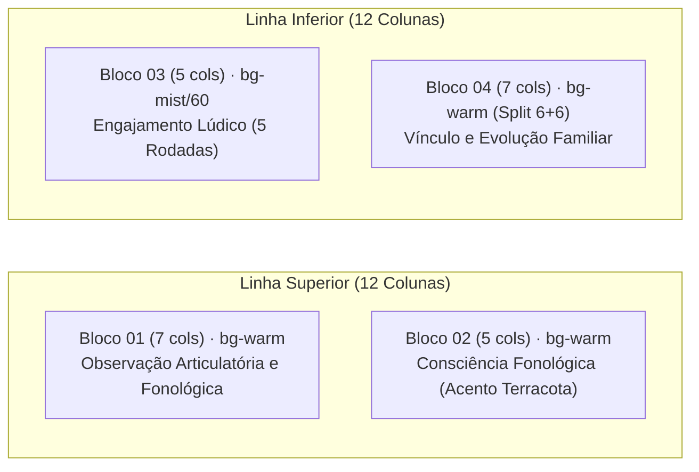

# Design System Impeccable — Tokens, Tipografia, Paleta e Direção Visual

> [!NOTE] Filosofia Visual Impeccable & Clareza Editorial
> O Design System do **FonoSync** segue rigorosamente as diretrizes **Impeccable** e do Segundo Cérebro do projeto: eliminação absoluta de *"AI Slop"* (gradientes neon genéricos, pílulas flutuantes sem função, estatísticas fictícias e ilustrações vetoriais infantilizadas desconectadas da clínica) em favor de uma **composição editorial calorosa, humana e clínica**, inspirada na serenidade e clareza do **Doxy.me**.

Conexões diretas no Segundo Cérebro:
- [[01-Arquitetura-Frontend-React-Rotas-Estado|Arquitetura Frontend React 19, Rotas e Estado]]
- [[03-Acessibilidade-IHC-e-Modulo-Triagem-Fonologica|Acessibilidade IHC e Módulo de Triagem Fonológica]]
- [[01-Visao-Geral-e-Proposito-Clinico|Visão Geral e Propósito Clínico]]

---

## 1. Princípios Anti-"AI Slop" e Composição Editorial

A interface do FonoSync atende simultaneamente **fonoaudiólogos em rotina clínica intensa**, **pais em busca de orientação confiável** e **crianças em atividades de rastreio**. Para equilibrar autoridade científica e acolhimento humano, aplicamos cinco regras fundamentais:

1. **Superfícies Quentes de Baixa Fadiga Visual:** Em vez de branco puro estéril (`#ffffff`) em toda a tela, alternamos superfícies de papel quente (`--color-warm: #f6f5f2`, `--color-canvas: #faf9f6`) e bruma azulada (`--color-mist: #eef3f5`) com divisórias sutis (`--color-line: #dedbd3`).
2. **Hierarquia Tipográfica Tripartida Intencional:** Títulos com serifas orgânicas (`Fraunces`), interface clínica de leitura rápida (`Plus Jakarta Sans`) e metadados técnicos/etiquetas em monoespaçada (`IBM Plex Mono`).
3. **Veracidade Clínica (Zero Métricas Inventadas):** Nenhum componente exibe contadores falsos de marketing. Os pilares do Hero destacam fatos reais da arquitetura: `0 a 6+ anos`, `Prontuário & Agenda` e `Leitura & A11y`.
4. **Fotografia Real e Contextualizada:** Todas as imagens retratam situações autênticas de terapia da fala, ponto articulatório, espelho clínico, consciência silábica e vínculo familiar.
5. **Tokens Semânticos Adaptativos:** Todas as cores são declaradas como variáveis CSS na diretiva `@theme` do Tailwind CSS v4 (`src/index.css`), permitindo mutação instantânea para Modo Escuro, Alto Contraste e Perfis de Daltonismo sem recarregar a árvore React.

---

## 2. Tipografia Intencional (`@theme` Font Stack)

Definida em `src/index.css` e aplicada globalmente via `@layer base`:

| Token CSS (`@theme`) | Família Tipográfica | Aplicação Semântica no FonoSync | Características Visuais e Métricas |
| :--- | :--- | :--- | :--- |
| `--font-serif` | `"Fraunces", Georgia, serif` | Todos os cabeçalhos (`h1` a `h6`), títulos de seção editorial, nomes de pacientes em destaque e palavras-alvo nos jogos fonológicos. | Serifada contemporânea de traço humano e acolhedor; `leading-[1.1]` a `[1.2]`, `tracking-[-0.02em]`. |
| `--font-sans` | `"Plus Jakarta Sans", system-ui, sans-serif` | Corpo de texto (`body`), formulários de anamnese, tabelas de pacientes, botões e controles do painel de acessibilidade. | Sans-serif geométrica humanista com excelente abertura de contraformas para leitura prolongada de prontuários. |
| `--font-mono` | `"IBM Plex Mono", monospace` | Sobretítulos editoriais (`01 · Observação Articulatória`), badges de faixa etária, códigos **CID-10**, registro **CRFa** e contadores tabulares. | Monoespaçada técnica que confere precisão clínica; usada com `uppercase` e `tracking-wider` / `tracking-widest`. |

---

## 3. Paleta de Cores Completa e Variáveis CSS (`src/index.css`)

### 3.1. Paleta Base Editorial (Modo Claro Padrão)

| Variável CSS | Hexadecimal | Papel Semântico na Interface |
| :--- | :--- | :--- |
| `--color-primary` | `#156082` | **Azul Clínico Editorial:** Ações primárias, indicadores ativos, links de destaque e selos clínicos. |
| `--color-on-primary` | `#ffffff` | Texto e ícones sobre superfícies `--color-primary` e `--color-danger`. |
| `--color-navy` | `#14222c` | **Marinho Editorial Profundo:** Títulos principais (`h1–h4`), estado hover de botões primários e seção CTA final. |
| `--color-band` | `#16242f` | **Faixa Estrutural:** Menu lateral (`aside`) dos painéis do profissional e do paciente, cabeçalho da triagem e `PageReader`. |
| `--color-on-band-muted` | `#c8dae6` | Texto secundário e legendas sobre a faixa escura `--color-band`. |
| `--color-mist` | `#eef3f5` | **Bruma Clínica:** Superfícies azuladas suaves para badges, blocos de leitor de voz e estados desabilitados. |
| `--color-warm` | `#f6f5f2` | **Papel Editorial Quente:** Fundo do Hero, cards do Bento Grid e seções alternadas da Landing Page. |
| `--color-warm-alt` | `#edeae3` | Variação quente mais densa para blocos de destaque secundário. |
| `--color-terracotta` | `#b86a52` | **Acento Humano Terracota:** Destaque editorial para blocos de consciência fonológica e calor humano. |
| `--color-surface` | `#ffffff` | Fundo de cartões clínicos, modais, inputs e superfícies elevadas. |
| `--color-canvas` | `#faf9f6` | Fundo da área de trabalho principal (`main`) nos dashboards de Profissional, Paciente e Triagem. |
| `--color-ink` | `#1e252b` | Cor principal de texto corrido de alta legibilidade. |
| `--color-muted` | `#52606b` | Texto secundário, subtítulos, descrições e metadados de apoio. |
| `--color-success` | `#1b6b4d` | **Verde Clínico:** Confirmações, status `Em acompanhamento`, pronúncia dentro do padrão e sessões realizadas. |
| `--color-warning` | `#9c5214` | **Âmbar de Atenção:** Status `Pré-cadastro`, variações fonológicas que merecem observação e alertas. |
| `--color-danger` | `#a32e35` | **Vermelho Clínico:** Erros de validação, exclusão de prontuário, parada de áudio e encaminhamento prioritário. |
| `--color-line` | `#dedbd3` | **Divisor Editorial:** Bordas sutis de cartões, tabelas e separadores de seção. |
| `--color-focus` | `#d9822b` | **Anel de Foco (`:focus-visible`):** Contorno sólido de `3px` (`4px` em alto contraste) com `outline-offset: 2px` para navegação por teclado. |
| `--color-accent` | `#e08e36` | **Âmbar Luminoso:** Ícones ativos, barra de progresso do leitor de voz e indicadores sobre `--color-band`. |

---

### 3.2. Matriz de Adaptação Temática: Dark Mode e Alto Contraste

O FonoSync altera os tokens na raiz (`:root`) através dos atributos `data-theme="dark"` e `data-contrast="high"`:

| Token CSS | Claro Padrão | Escuro (`data-theme="dark"`) | Alto Contraste Claro (`data-contrast="high"`) | Alto Contraste Escuro (`dark` + `high`) |
| :--- | :--- | :--- | :--- | :--- |
| `--color-primary` | `#156082` | `#6db3e0` | `#00427a` | `#8fd0ff` |
| `--color-on-primary` | `#ffffff` | `#0f1c25` | `#ffffff` | `#000000` |
| `--color-navy` | `#14222c` | `#dbe8f1` | `#000000` | `#ffffff` |
| `--color-band` | `#16242f` | `#0a1620` | `#000000` | `#0a1620` |
| `--color-mist` | `#eef3f5` | `#16293a` | `#ffffff` | `#000000` |
| `--color-surface` | `#ffffff` | `#0f1c25` | `#ffffff` | `#000000` |
| `--color-canvas` | `#faf9f6` | `#0b1720` | `#ffffff` | `#000000` |
| `--color-ink` | `#1e252b` | `#e3edf4` | `#000000` | `#ffffff` |
| `--color-muted` | `#52606b` | `#a3b7c6` | `#000000` | `#ffffff` |
| `--color-success` | `#1b6b4d` | `#5cc495` | `#00552f` | `#7dffb8` |
| `--color-warning` | `#9c5214` | `#e08a43` | `#6b2f00` | `#ffb36b` |
| `--color-danger` | `#a32e35` | `#f07a80` | `#8a0010` | `#ff9aa0` |
| `--color-line` | `#dedbd3` | `#2c4456` | `#000000` | `#ffffff` |

> [!TIP] Regras Adicionais de Alto Contraste e Modo Escuro
> - Em `:root[data-theme="dark"]`, a propriedade `color-scheme: dark` é ativada para adaptar barras de rolagem, seletores `<select>` e calendários nativos do navegador.
> - Em `:root[data-contrast="high"]`, todos os links sem background recebem sublinhado explícito (`text-decoration: underline; text-underline-offset: 3px`), campos de formulário assumem `border-color: currentColor` e o anel `:focus-visible` aumenta para `4px`.

---

### 3.3. Tokens Dinâmicos para Daltonismo e Interpolação `oklab`

Quando o usuário seleciona um modo de daltonismo (`data-color-vision`), o sistema recalibra as cores semânticas de status e utiliza **`color-mix(in oklab, ...)`** para recalcular automaticamente toda a escala de utilitários do Tailwind (`emerald`, `rose`, `amber`, `blue`), garantindo que badges e alertas em toda a aplicação respeitem o espectro visível do usuário:

| Modo (`data-color-vision`) | `--color-success` (Claro / Escuro) | `--color-warning` (Claro / Escuro) | `--color-danger` (Claro / Escuro) | Ajustes Extras |
| :--- | :--- | :--- | :--- | :--- |
| **`red-green`** (Protanopia / Deuteranopia) | `#0062a8` / `#5eaeea` (Azul seguro) | `#806300` / `#d9b23e` (Ocre/Dourado) | `#c0400a` / `#f08a4b` (Terracota/Laranja) | Substitui o eixo vermelho-verde por contraste azul-laranja/ocre. |
| **`tritan`** (Tritanopia) | `#1b6b4d` / `#5cc495` | `#a8326e` / `#ef86b9` (Magenta) | `#b3261e` / `#f07a80` (Rubi) | `--color-focus: #ff4f9a`, `--color-accent: #ff7ab6`. |
| **`mono`** (Monocromático) | Escala de cinza | Escala de cinza | Escala de cinza | Aplica `filter: grayscale(1)` no `:root`. |

---

## 4. Padrão de Botões (`src/components/buttonStyles.js`)

O utilitário `buttonClass(variant)` padroniza a ergonomia e a estética dos botões em toda a plataforma.

### 4.1. Classe Base Comum
```javascript
const base =
  'inline-flex min-h-11 items-center justify-center gap-2.5 rounded-[10px] border px-5 py-2.5 text-[15px] font-semibold tracking-[-0.01em] transition-all duration-150 disabled:pointer-events-none disabled:border-line disabled:bg-mist disabled:text-navy disabled:opacity-55';
```
- **Altura mínima acessível:** `min-h-11` (`44px` por padrão, expandindo automaticamente para `3.5rem` / `56px` quando `data-targets="large"` está ativo).
- **Raio de borda editorial:** `rounded-[10px]` (evita tanto cantos retos agressivos quanto pílulas `rounded-full` genéricas).
- **Microinteração tátil:** `active:translate-y-px` nas variantes `primary` e `secondary`.

### 4.2. Variantes Oficiais

| Variante | Classes Específicas | Uso Recomendado |
| :--- | :--- | :--- |
| **`primary`** | `border-primary bg-primary text-on-primary shadow-[0_1px_2px_rgba(20,34,44,0.12)] hover:bg-navy hover:border-navy active:translate-y-px` | Ação principal da tela (ex.: *Iniciar rastreio fonológico*, *Entrar na plataforma*, *Salvar preferências*). |
| **`secondary`** | `border-navy/25 bg-surface text-navy hover:border-navy hover:bg-warm active:translate-y-px` | Ações secundárias de mesmo nível hierárquico (ex.: *Acessibilidade*, *Conhecer o prontuário clínico*, *Aumentar/Reduzir fonte*). |
| **`tertiary`** | `border-transparent bg-transparent text-navy hover:bg-warm hover:text-primary` | Ações de navegação auxiliar ou reversão (ex.: *Voltar*, *Ouvir página*, *Restaurar padrão*). |
| **`danger`** | `border-danger bg-danger text-on-primary hover:brightness-[0.88]` | Ações destrutivas ou de interrupção imediata (ex.: *Parar leitura*, exclusão de registros). |

---

## 5. Bento Grid Assimétrico e Direção de Fotografia Real

### 5.1. Estrutura do Bento Grid (`LandingPage.jsx`)
Na seção *"Por que construímos o FonoSync"*, utilizamos um **Bento Grid de 12 colunas (`lg:grid-cols-12`)** com ritmo visual assimétrico (`7 + 5` na linha superior e `5 + 7` na linha inferior) e cartões com raio `rounded-[24px]` e borda `border-line`:



### 5.2. Catálogo de Fotografia Real Curada (`src/assets/images/care/`)
Todas as fotografias foram selecionadas para refletir práticas clínicas reais da fonoaudiologia brasileira e possuem textos alternativos (`alt`) descritivos e legendas (`figcaption`) técnicas:

| Arquivo em `src/assets/images/care/` | Contexto de Uso na Interface | Descrição Clínica e Técnica (`alt`) |
| :--- | :--- | :--- |
| `consultorio-familia-atendimento.jpg` | Hero Principal (`LandingPage.jsx`) | Fonoaudióloga em atendimento clínico acolhedor com criança e mãe no consultório. |
| `terapia-fala-articulacao.jpg` | Bento Grid · Bloco 01 (7 colunas) | Fonoaudióloga demonstrando ponto articulatório no queixo com criança durante sessão. |
| `terapia-espelho-alfabeto.jpg` | Bento Grid · Bloco 02 (5 colunas) | Fonoaudióloga trabalhando com espelho clínico e prancha de letras com criança. |
| `crianca-quadro-fonemas.jpg` | Bento Grid · Bloco 03 (5 colunas) | Criança sorrindo enquanto interage com quadro pedagógico ao lado da terapeuta. |
| `celebracao-terapia-evolucao.jpg` | Bento Grid · Bloco 04 (7 colunas) | Terapeuta e criança comemorando conquista com toque de mãos. |
| `silabas-girafa-ludico.jpg` | Percurso 01 · Famílias e Crianças | Criança montando sílabas da palavra girafa com cartões ilustrados sobre mesa de madeira. |
| `fonoaudiologa-planejamento.jpg` | Percurso 02 · Fonoaudiólogos e Clínicas | Fonoaudióloga em seu consultório planejando atendimento clínico na mesa de trabalho. |
| `atividade-leitura-clinica.jpg` | Percurso 03 · Escolas e Educadores | Profissional acompanhando criança em atividade de leitura e reconhecimento de letras. |
| `fonoaudiologa-linguagem.jpg` | Percurso 04 · Instituições e Redes | Fonoaudióloga consultando livro de mapas conceituais em fonoaudiologia e linguagem. |
