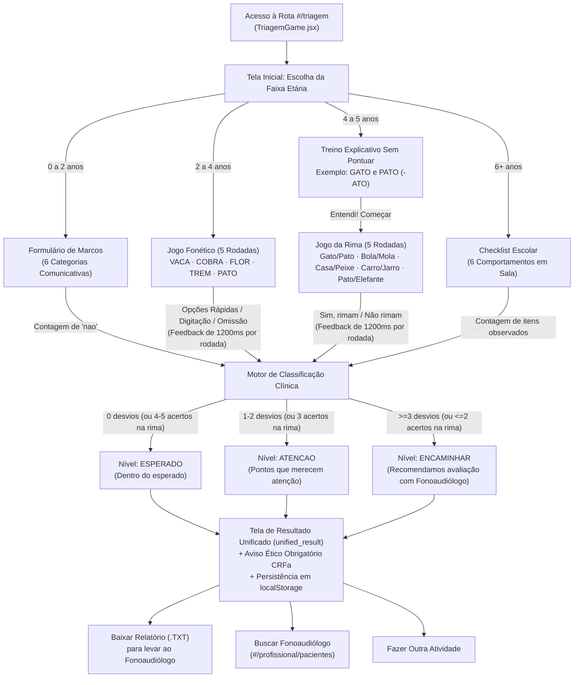

# Acessibilidade IHC Nativa e Módulo de Triagem Fonológica (0 a 6+ Anos)

> [!NOTE] Inclusão como Primeiro Plano Arquitetural
> No **FonoSync**, a acessibilidade (IHC / A11y) não é um widget terceirizado sobreposto à página: é uma **camada nativa do motor de renderização** gerenciada pelo `A11yContext`, integrada diretamente às variáveis CSS do Tailwind v4, à **Web Speech API** (`speechSynthesis`) e à **CSS Custom Highlight API** (`::highlight(fonosync-leitura)`). Da mesma forma, o **Módulo de Rastreio Fonológico (`TriagemGame.jsx`)** foi projetado com ergonomia cognitiva para famílias, educadores e crianças de **0 a 6+ anos**.

Conexões diretas no Segundo Cérebro:
- [[01-Arquitetura-Frontend-React-Rotas-Estado|Arquitetura Frontend React 19, Rotas e Estado]]
- [[02-Design-System-Impeccable-Tokens-e-Tipografia|Design System Impeccable, Tokens e Tipografia]]
- [[01-Visao-Geral-e-Proposito-Clinico|Visão Geral e Propósito Clínico]]

---

## 1. Arquitetura de Acessibilidade Nativa (`A11yContext`, `AccessibilityPanel`, `PageReader`)

### 1.1. Fluxo do Motor de Acessibilidade e DOM Root
Sempre que o usuário altera qualquer preferência no `AccessibilityPanel` (`src/components/AccessibilityPanel.jsx`), o hook `useLayoutEffect` no `A11yContext` (`src/context/A11yContext.jsx`) executa `applyToDocument(settings)` antes da pintura do frame do navegador, aplicando atributos de dados (`data-*`) e variáveis CSS diretamente no elemento `<html>` (`document.documentElement`).

> [!TIP] Portal DOM Contra Quebra de `position: fixed`
> O componente `A11yModal.jsx` utiliza `createPortal(<AccessibilityPanel />, document.body)` para garantir que o painel de acessibilidade seja renderizado fora de cabeçalhos com `backdrop-blur-md`, evitando que o filtro CSS crie um novo bloco de contenção e quebre o posicionamento fixo.

### 1.2. Leitura de Página com Web Speech API e CSS Custom Highlight API
O recurso **"Ouvir página"** combina síntese de voz natural em português brasileiro (`pt-BR`) com marcação visual em tempo real palavra por palavra (`src/utils/readingHighlight.js`):

1. **Coleta Inteligente da Árvore DOM (`collectPageText`):**
   - Utiliza `document.createTreeWalker(root, NodeFilter.SHOW_TEXT, ...)` percorrendo `<main>` (ou `document.body`).
   - Ignora automaticamente nós ocultos (`!parent.checkVisibility()`), elementos decorativos (`[aria-hidden="true"]`), scripts, estilos, modais abertos (`[role="dialog"]`) e controles marcados com `[data-a11y-skip]` (como o próprio `PageReader` e o `AccessibilityPanel`).
   - Mapeia a posição exata de início (`start`) de cada nó de texto na string contínua da página.
2. **Segmentação de Frases (`splitPageText`):**
   - Divide o texto coletado (até `MAX_TEXT = 8000` caracteres) em sentenças naturais pontuadas, quebrando blocos longos em trechos de no máximo `MAX_CHUNK = 200` caracteres para evitar truncamentos no motor de síntese dos navegadores.
3. **Heurística de Seleção de Voz (`resolveVoice`):**
   - Filtra vozes de língua portuguesa (`/^pt([-_]|$)/i`) e atribui pontuação maior para vozes neurais/naturais (`natural|neural|online` = `+4`, `google` = `+2`, `pt-BR` = `+1`).
   - Seleciona a voz correspondente ao gênero escolhido (`Feminina` ou `Masculina`) via expressões regulares de nomes de vozes conhecidas. Caso o sistema operacional possua apenas uma voz neutra/feminina e o usuário escolha voz masculina, aplica fallback automático de tom (`MALE_FALLBACK_PITCH = 0.6`).
4. **Marca-Texto Dinâmico e Auto-Scroll (`highlightWordAt`):**
   - A cada evento `utterance.onboundary` (`event.name === 'word'`), realiza busca binária (`findPart`) para localizar o nó DOM exato, cria um objeto `Range` cobrindo os limites Unicode da palavra (`/[\\p{L}\\p{N}'-]/u`) e registra o destaque via `CSS.highlights.set('fonosync-leitura', new Highlight(range))`.
   - O pseudo-elemento `::highlight(fonosync-leitura)` em `src/index.css` pinta a palavra ativa com fundo amarelo de alto contraste (`#ffe45c`) e texto escuro (`#172c3a`).
   - Se a palavra lida sair da zona confortável de visão (`box.top < 80 || box.bottom > window.innerHeight - 200`), a página rola automaticamente (`window.scrollBy`), respeitando `behavior: 'auto'` caso a redução de movimento (`data-motion="reduce"`) esteja ativa.
5. **Player Flutuante (`PageReader.jsx`):**
   - Exibe o título do `<h1>` da página atual, cronômetro estimado (`CHARS_PER_SECOND = 14`), barra de progresso visual, controles de **Reproduzir**, **Pausar**, **Parar**, **Reiniciar**, troca instantânea de **Voz** (Feminina/Masculina), **Velocidade** (`0,75×`, `1×`, `1,5×`, `2×`) e **Volume** (`0%` a `100%`).

---

## 2. Controles Visuais, Motores e Cognitivos de IHC

Todas as preferências são persistidas na chave `fonosync:acessibilidade` do `localStorage` e podem ser restauradas ao padrão a qualquer momento:

| Controle de Acessibilidade | Atributo / Variável em `:root` | Opções e Limites (`constants.js`) | Impacto Técnico na Interface (`index.css`) |
| :--- | :--- | :--- | :--- |
| **Tamanho do Texto** | `root.style.fontSize` | `80%` a `140%` (passo de `10%`, padrão `100%`) | Escala proporcionalmente todas as unidades `rem` da aplicação. |
| **Alto Contraste** | `data-contrast="high"` | Booleano (`true` / `false`) | Ativa paleta monocromática extrema (preto/branco puro, azul `#00427a` / `#8fd0ff`), sublinha links, engrossa foco para `4px` e bloqueia cores customizadas conflitantes. |
| **Modo Escuro** | `data-theme="dark"` | Booleano (`true` / `false`) | Converte superfícies para tons noturnos profundos (`#0b1720`, `#0f1c25`) e ativa `color-scheme: dark`. |
| **Reduzir Animações** | `data-motion="reduce"` | Booleano + `@media (prefers-reduced-motion: reduce)` | Força `animation-duration: 0.01ms !important`, `transition-duration: 0.01ms !important` e `scroll-behavior: auto !important`. |
| **Alvos de Toque Ampliados** | `data-targets="large"` | Booleano (`true` / `false`) | Amplia `min-height` de todos os `button:not([role="switch"])`, `input`, `select`, `a` e `label` de swatches para **`3.5rem` (`56px`)**, facilitando o uso por crianças ou pessoas com restrição motora fina. |
| **Modo de Cor (Daltonismo)** | `data-color-vision` | `default`, `red-green` (Protanopia/Deuteranopia), `tritan` (Tritanopia), `mono` (Monocromático) | Recalibra `--color-success`, `--color-warning`, `--color-danger` e reconstrói as escalas Tailwind via `color-mix(in oklab, ...)`. |
| **Cor Customizada do Texto** | `data-a11y-text` / `--a11y-text` | **Claro:** Padrão, Preto (`#000000`), Grafite (`#172c3a`), Azul-escuro (`#0b2e4f`), Marrom (`#4a2c12`), Vinho (`#5a1023`). **Escuro:** Padrão, Branco (`#ffffff`), Cinza-claro (`#d7dde3`), Creme (`#f5ecd7`), Amarelo-claro (`#fff3b0`), Azul-claro (`#cfe6f7`). | Sobrescreve `--color-ink`, `--color-navy` e calcula `--color-muted` proporcionalmente com `color-mix(in srgb, ...)`. |
| **Cor Customizada dos Botões** | `data-a11y-button` / `--a11y-button` | **Claro:** Padrão, Verde (`#1f6f43`), Roxo (`#5b3fa0`), Vinho (`#8a1c3c`), Laranja (`#a3470d`), Preto (`#000000`). **Escuro:** Padrão, Verde-claro (`#7fd1a6`), Lilás (`#b9a5ec`), Rosa (`#f2a2bb`), Pêssego (`#f5b47a`), Branco (`#ffffff`). | Sobrescreve `--color-primary` quando o alto contraste não está ativo. |
| **Espaçamento Entre Linhas** | `data-leading` / `--a11y-leading` | `normal`, `1.5` (`1,5×`), `2` (`2×`) | Aplica `line-height: var(--a11y-leading) !important` em `body *` para apoio a pessoas com dislexia ou baixa visão. |
| **Espaçamento Entre Letras** | `data-tracking` / `--a11y-tracking` | `normal`, `0.05em` (Ampliado), `0.12em` (Máximo) | Aplica `letter-spacing: var(--a11y-tracking) !important` em `body *`. |

---

## 3. Especificação Completa do Módulo de Rastreio/Triagem Fonológica (`TriagemGame.jsx`)

O componente `src/components/TriagemGame.jsx` implementa o **Módulo de Rastreio Fonoaudiológico Precoce** acessível na rota `#/triagem`.

> [!IMPORTANT] Princípio Clínico: "Quem Escuta a Criança é Você!"
> O módulo opera deliberadamente **sem captura de áudio por microfone ou reconhecimento automático de voz (ASR)** na triagem infantil. Em fonoaudiologia pediátrica, microfones domésticos distorcem fricativas (`/f/`, `/v/`, `/s/`, `/z/`) e encontros consonantais. Ao colocar o adulto responsável ou educador como mediador que escuta a criança e seleciona a produção oral observada em botões rápidos (ou digitação livre), o FonoSync garante **alta confiabilidade clínica**, **zero coleta de biometria vocal infantil (LGPD)** e fortalecimento do vínculo familiar.

---

### 3.1. Faixa 1: 0 a 2 Anos — Marcos Iniciais da Comunicação (`form02`)
Questionário estruturado em **6 dimensões do desenvolvimento comunicativo precoce**, com três níveis de resposta (`sim`, `parcial`, `nao`):

| # | Categoria Clínica | Pergunta Orientadora ao Responsável | Opções de Resposta |
| :---: | :--- | :--- | :--- |
| **1** | **Comunicação Verbal** | A criança fala pelo menos 10 palavras reconhecíveis (ex.: mamãe, água, não, dá)? | `✅ Sim, claramente` (`sim`) · `⚠️ Algumas vezes` (`parcial`) · `❌ Ainda não` (`nao`) |
| **2** | **Compreensão** | A criança entende ordens simples sem gestos, como "pega a bola" ou "vem aqui"? | `✅ Sim, sempre` (`sim`) · `⚠️ Às vezes` (`parcial`) · `❌ Raramente` (`nao`) |
| **3** | **Imitação Vocal** | A criança imita sons ou palavras que o adulto fala, mesmo que com pronúncia diferente? | `✅ Sim, com frequência` (`sim`) · `⚠️ Raramente` (`parcial`) · `❌ Não imita` (`nao`) |
| **4** | **Atenção Auditiva** | A criança reage quando é chamada em tom normal (sem gritar)? | `✅ Sempre reage` (`sim`) · `⚠️ Às vezes ignora` (`parcial`) · `❌ Quase não reage` (`nao`) |
| **5** | **Combinação de Palavras** | A criança já junta duas palavras para formar frases simples (ex.: "quer água", "cadê mamãe")? | `✅ Sim, com frequência` (`sim`) · `⚠️ Começando agora` (`parcial`) · `❌ Ainda não` (`nao`) |
| **6** | **Intenção Comunicativa** | A criança aponta, gesticula ou usa outros recursos para pedir o que quer além de chorar? | `✅ Sim, muito` (`sim`) · `⚠️ Às vezes` (`parcial`) · `❌ Quase nunca` (`nao`) |

---

### 3.2. Faixa 2: 2 a 4 Anos — Jogo Fonético / Nomeação e Processos Fonológicos (`game24`)
Composto por **5 rodadas** de nomeação espontânea de figuras (`"O que é isso?"`). Para cada palavra-alvo, o sistema oferece **3 botões rápidos** mapeados para os processos fonológicos mais frequentes na clínica infantil, além dos botões **"A criança não respondeu"** (omissão total) e **"Outra pronúncia... (Digitar)"** (input de texto livre comparado com `currentWord.target`):

| Rodada | Palavra-Alvo & Emoji | Cadeia Fonêmica (`phonemes`) | Opção 1 (Padrão Esperado) | Opção 2 (Processo Fonológico / Troca) | Opção 3 (Processo Fonológico / Troca) |
| :---: | :--- | :--- | :--- | :--- | :--- |
| **1/5** | **VACA** 🐄 | `/v/ + /a/ + /k/ + /a/` | **"Vaca"** (`isCorrect: true`) *Pronúncia correta do fonema /v/* | **"Faca"** (`isCorrect: false`) *Troca de /v/ → /f/ (Ensurdecimento de fricativa)* | **"Baca"** (`isCorrect: false`) *Troca de /v/ → /b/ (Oclusivização)* |
| **2/5** | **COBRA** 🐍 | `/k/ + /o/ + /b/ + /r/ + /a/` | **"Cobra"** (`isCorrect: true`) *Pronúncia correta com encontro consonantal* | **"Coba"** (`isCorrect: false`) *Omissão do /r/ em encontro consonantal* | **"Corra"** (`isCorrect: false`) *Troca do /b/ medial* |
| **3/5** | **FLOR** 🌸 | `/f/ + /l/ + /o/ + /r/` | **"Flor"** (`isCorrect: true`) *Pronúncia correta* | **"For"** (`isCorrect: false`) *Redução de encontro consonantal /fl/ → /f/* | **"Fror"** (`isCorrect: false`) *Troca de líquida /fl/ → /fr/* |
| **4/5** | **TREM** 🚂 | `/t/ + /r/ + /e/ + /m/` | **"Trem"** (`isCorrect: true`) *Pronúncia correta* | **"Tem"** (`isCorrect: false`) *Redução do encontro /tr/* | **"Crem"** (`isCorrect: false`) *Troca de /t/ → /k/* |
| **5/5** | **PATO** 🦆 | `/p/ + /a/ + /t/ + /u/` | **"Pato"** (`isCorrect: true`) *Pronúncia correta* | **"Bato"** (`isCorrect: false`) *Troca de /p/ → /b/ (Sonorização de oclusiva)* | **"Tato"** (`isCorrect: false`) *Troca de /p/ → /t/ (Anteriorização)* |

---

### 3.3. Faixa 3: 4 a 5 Anos — Jogo da Rima e Consciência Fonológica (`rima45`)
Avalia a percepção de rimas (habilidade metafonológica preditora da alfabetização).
- **Etapa 0 (Treino Explicativo Sem Pontuação):** Antes de iniciar a contagem, exibe uma tela pedagógica explicando o conceito de rima com o exemplo **🐱 GATO e 🦆 PATO** (*"Terminam com o mesmo som (-ATO), então SIM, elas rimam!"*). As rodadas só começam quando o mediador clica em `"Entendi! Começar as Rodadas →"`.
- **As 5 Rodadas Valendo Pontuação:**

| Rodada | Palavra 1 | Palavra 2 | Gabarito Clínico (`rima`) | Habilidade Avaliada |
| :---: | :--- | :--- | :---: | :--- |
| **1/5** | 🐱 **GATO** | 🦆 **PATO** | `true` (**Rimam**) | Identificação de rima consoante/vogal tônica `-ATO`. |
| **2/5** | ⚽ **BOLA** | 🌀 **MOLA** | `true` (**Rimam**) | Identificação de rima aberta `-OLA`. |
| **3/5** | 🏠 **CASA** | 🐟 **PEIXE** | `false` (**Não rimam**) | Discriminação negativa (rejeitar par sem semelhança final). |
| **4/5** | 🚗 **CARRO** | 🏺 **JARRO** | `true` (**Rimam**) | Identificação de rima com vibrante múltipla `-ARRO`. |
| **5/5** | 🦆 **PATO** | 🐘 **ELEFANTE** | `false` (**Não rimam**) | Discriminação negativa com contraste de extensão silábica. |

---

### 3.4. Faixa 4: 6+ Anos — Checklist Escolar em Sala de Aula (`check6`)
Voltado a professores e famílias de crianças no Ensino Fundamental para observação de sinais nas últimas 3 semanas:
1. *A criança evita falar em voz alta ou participar de atividades orais.*
2. *Troca sons que colegas da mesma faixa etária não trocam.*
3. *Tem dificuldade em rimar palavras ou identificar sons iniciais.*
4. *Apresenta gagueira ou travamentos frequentes na fala.*
5. *Demonstra dificuldade em seguir instruções verbais da aula.*
6. *Apresenta desempenho muito abaixo dos colegas na alfabetização.*

---

## 4. Lógica das Rodadas, Cálculo de Desempenho e Devolutiva Ética Acolhedora

### 4.1. Algoritmo de Classificação por Nível de Atenção
Ao concluir qualquer uma das 4 atividades, o sistema classifica o resultado em um dos 3 níveis (`ESPERADO`, `ATENCAO`, `ENCAMINHAR`), salva no histórico local (`fonosync:triagem_history`) e navega para a tela de resultado unificado (`unified_result`):

| Atividade / Faixa Etária | Total de Itens | Critério para `ESPERADO` (Verde) | Critério para `ATENCAO` (Âmbar) | Critério para `ENCAMINHAR` (Rosa/Vermelho) |
| :--- | :---: | :--- | :--- | :--- |
| **Formulário de Marcos (0–2 anos)** | 6 perguntas | `0` respostas `"nao"` | `1` resposta `"nao"` | `>= 2` respostas `"nao"` |
| **Jogo Fonético (2–4 anos)** | 5 rodadas | `0` trocas/omissões (`5/5` corretas) | `1` ou `2` trocas (`3/5` ou `4/5` corretas) | `>= 3` trocas/omissões (`<= 2/5` corretas) |
| **Jogo da Rima (4–5 anos)** | 5 rodadas | `4` ou `5` acertos | Exatamente `3` acertos | `<= 2` acertos |
| **Checklist Escolar (6+ anos)** | 6 sinais | `0` sinais marcados (`6/6`) | `1` ou `2` sinais marcados | `>= 3` sinais marcados |

### 4.2. Devolutiva Ética Acolhedora e Exportação de Relatório (`.txt`)
A tela `renderUnifiedResultScreen()` foi desenhada para nunca alarmar a família nem substituir o ato clínico fonoaudiológico:

- **Mensagens Acolhedoras Calibradas:**
  - `ESPERADO`: *"Desenvolvimento Dentro do Esperado"* — incentiva a continuidade de leitura de histórias, conversas e cantigas.
  - `ATENCAO`: *"Pontos que Merecem Atenção"* — explica que variações podem fazer parte do ritmo próprio da criança e sugere observar nas próximas semanas ou conversar tranquilamente com um fonoaudiólogo.
  - `ENCAMINHAR`: *"Recomendamos Conversar com Fonoaudiólogo"* — destaca de forma positiva que procurar apoio precoce facilita o desenvolvimento da comunicação e a segurança da criança.
- **Aviso Ético Fixo Obrigatório:**
  > ⚠️ *"Este resultado não é um diagnóstico. Ele apenas indica se vale a pena procurar um fonoaudiólogo para avaliação."*
- **Exportação de Relatório para o Consultório (`downloadReportTxt`):**
  Gera instantaneamente via `Blob` (`text/plain;charset=utf-8`) o arquivo `rastreio-fonosync-${id}.txt` contendo data, faixa etária, atividade, resultado, score, detalhamento item a item do que a criança respondeu e nota de orientação clínica, permitindo que os pais levem o registro para a primeira consulta com o fonoaudiólogo.

---

## 5. Diagrama de Fluxo do Módulo de Triagem e Acessibilidade

