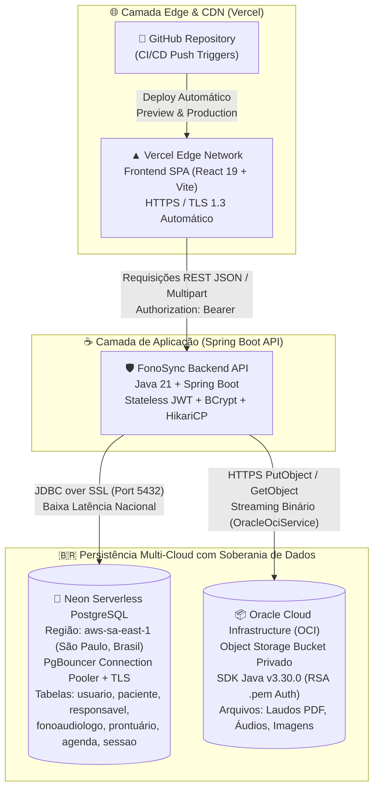

# ☁️ Infraestrutura Multi-Cloud (Vercel, Neon SP, Oracle OCI), Segurança e LGPD

> [!NOTE] Navegação no Second Brain
> - **Índice Central:** [[00-FonoSync-Second-Brain-MOC|00 · MOC Índice Central]]
> - **Arquitetura & DER:** [[01-System-Design-e-Arquitetura-Geral|01 · System Design, Diagramas C4 e DER]]
> - **Engenharia & SOLID:** [[01-Principios-SOLID-e-Padroes-de-Projeto|01 · Princípios SOLID e Padrões de Projeto]]
> - **Catálogo CRUD & Endpoints:** [[02-Catalogo-CRUD-Endpoints-e-Regras-de-Negocio|02 · Catálogo CRUD, Endpoints e GlobalExceptionHandler]]

---

## 1. Topologia Multi-Cloud do FonoSync

O ecossistema **FonoSync** adota uma arquitetura **Multi-Cloud Best-of-Breed**, selecionando o provedor de nuvem mais eficiente para cada camada da aplicação:
1. **Vercel Edge Network (Frontend SPA):** Entrega global de baixa latência da aplicação React 19 + TypeScript.
2. **Neon Serverless PostgreSQL (Dados Relacionais Clínicos):** Banco de dados PostgreSQL 16 gerenciado na região de **São Paulo (`aws-sa-east-1`)** com pooler de conexões integrado.
3. **Oracle Cloud Infrastructure — OCI Object Storage (Arquivos e Mídias Clínicas):** Armazenamento de objetos de alta durabilidade para laudos em PDF, exames audiológicos e gravações de voz de pacientes.



---

## 2. Detalhamento dos Provedores Cloud

### 2.1 Vercel — Hospedagem Frontend SPA e CI/CD
- **Integração Contínua (CI/CD):** Conectada diretamente ao repositório GitHub do projeto, cada commit na branch principal dispara o pipeline de build (`vite build`), validação de tipos TypeScript e publicação atômica na CDN global da Vercel.
- **Roteamento SPA e Segurança de Borda:** Servido integralmente sob **HTTPS (TLS 1.3)**, garantindo que os tokens JWT e dados clínicos trafeguem criptografados entre o navegador do fonoaudiólogo/família e a infraestrutura.

### 2.2 Neon Serverless PostgreSQL — Migração para `aws-sa-east-1` (São Paulo)
O banco de dados relacional do FonoSync é hospedado no **Neon Serverless PostgreSQL**, tendo passado por uma decisão arquitetural estratégica de **migração para a região `aws-sa-east-1` (São Paulo, Brasil)**:
1. **Redução Drástica de Latência (RTT):** Clínicas, fonoaudiólogos e famílias brasileiras acessam o sistema a partir do território nacional. A alocação do banco em São Paulo reduz o *Round-Trip Time* de consultas JPA/Hibernate de ~140ms (EUA) para **< 15ms**, tornando o carregamento do prontuário longitudinal e da agenda instantâneo.
2. **Soberania Nacional de Dados e Conformidade Legal:** Manter dados pessoais e clínicos sensíveis de crianças e adolescentes em datacenters localizados em território brasileiro (`sa-east-1`) simplifica a governança jurídica perante a **LGPD (Lei nº 13.709/2018)**, evitando transferências internacionais desnecessárias de dados de saúde.
3. **Connection Pooling (`PgBouncer` + `HikariCP`):** Combina o pooler nativo do Neon com o HikariCP do Spring Boot para suportar picos de conexões simultâneas sem exaurir recursos de memória, além de utilizar *Compute Autoscaling* e *Branching* para ambientes de homologação.

### 2.3 Oracle Cloud Infrastructure (OCI Object Storage) — Armazenamento de Anexos
Para evitar o inchamento (*bloat*) do banco PostgreSQL com arquivos binários pesados (`BYTEA`), o FonoSync implementa o padrão **External Blob Storage + Metadata Reference** por meio da classe `OracleOciService`:

```java
// OracleOciService.java — Upload seguro via OCI Java SDK v3.30.0
public String uploadFile(MultipartFile file) {
    try {
        AuthenticationDetailsProvider provider = new ConfigFileAuthenticationDetailsProvider("DEFAULT");
        ObjectStorage client = ObjectStorageClient.builder().build(provider);

        // Previne colisão de nomes no bucket gerando prefixo UUID v4
        String fileKey = UUID.randomUUID().toString() + "-" + file.getOriginalFilename();

        InputStream inputStream = file.getInputStream();
        PutObjectRequest putObjectRequest = PutObjectRequest.builder()
                .namespaceName(namespaceName)
                .bucketName(bucketName)
                .objectName(fileKey)
                .putObjectBody(inputStream)
                .contentLength(file.getSize())
                .contentType(file.getContentType())
                .build();

        client.putObject(putObjectRequest);
        client.close();

        return fileKey; // Salvo na coluna 'filekey' da tabela 'anexo' no Neon PostgreSQL
    } catch (Exception e) {
        throw new StorageException("Falha ao enviar arquivo para a Oracle OCI: " + e.getMessage(), e);
    }
}
```
- **Isolamento do Bucket:** O bucket na Oracle Cloud **não é público**. Nenhum usuário externo consegue acessar um laudo adivinhando uma URL. Todo acesso passa obrigatoriamente pelo endpoint autenticado `GET /api/attachments/{id}/download`, onde o backend valida o token JWT do usuário antes de buscar os bytes na OCI via chave privada RSA (`.pem`).

---

## 3. Segurança da Informação e Decisões Arquiteturais

### 3.1 Autenticação Stateless com Spring Security 6 + JWT (HMAC256)
A API foi projetada como **100% Stateless** (`SessionCreationPolicy.STATELESS`), eliminando sessões de servidor (`JSESSIONID`) e vulnerabilidades de **CSRF**:

1. **Emissão do Token (`TokenService`):** Utiliza a biblioteca `com.auth0:java-jwt:4.4.0` com algoritmo simétrico **`HMAC256`** e segredo injetado por variável de ambiente (`${api.security.token.secret}`). O payload do JWT inclui:
   - `iss` (Issuer): `"fonosync-api"`
   - `sub` (Subject): E-mail único do usuário (`user.getEmail()`)
   - `role` (Custom Claim): Perfil de autorização (`ROLE_FONO`, `ROLE_PACIENTE` ou `ROLE_ADMIN`)
   - `exp` (Expiration): Janela de validade de **24 horas** (`ZoneOffset.of("-03:00")` — Horário de Brasília).
2. **Interceptação por Requisição (`SecurityFilter`):** Estende `OncePerRequestFilter`, extrai o cabeçalho `Authorization: Bearer <token>`, valida a assinatura criptográfica e a data de expiração, carrega o `UserEntity` e popula o `SecurityContextHolder`.
3. **Respostas de Erro de Segurança Padronizadas (`RestAuthenticationEntryPoint`):** Quando um cliente tenta acessar um recurso protegido sem token ou com token inválido/expirado, o `RestAuthenticationEntryPoint` intercepta a `AuthenticationException` e devolve um JSON `StandardError` com status `401 Unauthorized` e `UTF-8`, mantendo total consistência com o `GlobalExceptionHandler`.
4. **Controle de Acesso Baseado em Papéis (RBAC com `@EnableMethodSecurity`):** Os endpoints clínicos críticos utilizam `@PreAuthorize("hasAnyRole('FONO', 'ADMIN')")` para criação/leitura/edição de prontuários e `@PreAuthorize("hasRole('ADMIN')")` para exclusão física (`DELETE /api/paciente/{id}/delete`).

---

### 3.2 Criptografia de Senhas com BCrypt (Hash Irreversível com Salt)
Nenhuma senha em texto puro é armazenada ou trafegada nos logs do FonoSync. O bean `BCryptPasswordEncoder` configurado em `SecurityConfig` aplica a função de derivação de chave **BCrypt**:
- **Salt Aleatório Embutido:** Cada senha criptografada por `passwordEncoder.encode(dto.password())` gera um *salt* criptográfico único de 128 bits embutido no próprio hash resultante (formato `$2a$10$...`).
- **Resistência a Rainbow Tables e Brute-Force:** Mesmo que dois usuários escolham exatamente a mesma senha, seus hashes na coluna `senha` da tabela `usuario` serão completamente diferentes, e o fator de custo computacional do BCrypt inviabiliza ataques de força bruta por GPU.

---

### 3.3 Decisão Arquitetural Crítica: Por que `CPF` e `CRFa` NÃO usam Hash Irreversível (BCrypt)?

> [!IMPORTANT] Pergunta Clássica de Banca e Auditoria de Arquitetura
> *"Se a senha do usuário é armazenada com hash irreversível BCrypt por segurança, por que o **CPF** (do Paciente e do Responsável) e o **CRFa** (do Fonoaudiólogo) são armazenados como texto legível/indexável no banco de dados?"*

Essa é uma decisão deliberada de **Engenharia de Dados e Domínio Clínico**, fundamentada em **4 pilares técnicos e legais**:

| Critério Técnico / Clínico | `senha` (`UserEntity`) | `cpf` (`PatientEntity` / `GuardianEntity`) | `crfa` (`ProfessionalEntity`) |
| :--- | :--- | :--- | :--- |
| **Natureza do Dado** | Segredo de Autenticação (Credencial) | Identificador Civil Nacional Único | Registro Público de Habilitação Profissional |
| **Algoritmo / Formato** | **Hash Irreversível com Salt (`BCrypt`)** | **Texto Indexado (`VARCHAR UNIQUE`)** | **Texto Indexado (`VARCHAR UNIQUE`)** |
| **Precisa ser exibido na tela ou impresso em laudos?** | ❌ **NUNCA** (Nem o próprio sistema precisa saber a senha original) | ✅ **SIM** (Obrigatório em cabeçalho de prontuário, recibos e laudos clínicos) | ✅ **SIM** (Obrigatório por lei em qualquer carimbo, assinatura de laudo e parecer fonoaudiológico) |
| **Precisa de busca exata `WHERE` e constraint `UNIQUE` no SQL?** | ❌ Não (Validado via `BCrypt.matches(raw, hash)` após buscar pelo e-mail) | ✅ **SIM** (`existsByCpfPatient`, `findByCpf`, constraint `UNIQUE` no Postgres) | ✅ **SIM** (`findByCrfa`, constraint `UNIQUE` no Postgres) |

#### Detalhamento dos 4 Motivos Técnicos:
1. **Inviabilidade de Indexação `UNIQUE` e Busca Direta com BCrypt:**
   Como o BCrypt adiciona um *salt* aleatório a cada execução, aplicar `BCrypt.encode("12345678901")` duas vezes gera dois hashes completamente distintos. Se o CPF fosse salvo com BCrypt:
   - A constraint `UNIQUE` do PostgreSQL na coluna `cpf_paciente` e `cpf` deixaria de funcionar (permitindo cadastrar o mesmo CPF dezenas de vezes).
   - As queries de conciliação `guardianRepository.findByCpf(cpf)` e `patientRepository.existsByCpfPatient(cpf)` seriam impossíveis via índice B-Tree (`O(log N)`), exigindo carregar **todos os registros da tabela na memória RAM da aplicação** para testar `matches()` um por um (`O(N)`), causando colapso de performance.
2. **Exigência Legal e Clínica de Leitura Reversível (Prontuário e Laudos):**
   Um hash criptográfico (`SHA-256` ou `BCrypt`) é uma função **unidirecional (irreversível)**. Na prática clínica, o sistema **precisa recuperar e exibir o valor original** do CPF do paciente e do responsável para emitir relatórios, encaminhamentos médicos, laudos fonoaudiológicos com CID-10 e termos de consentimento. Com hash irreversível, o dado original seria perdido para sempre no momento do cadastro.
3. **Caráter Público e Regulatório do `CRFa`:**
   O número de inscrição no **Conselho Regional de Fonoaudiologia (`CRFa`)** não é um dado secreto; pelo contrário, é uma informação pública de transparência regulatória que **deve constar ostensivamente** junto ao nome do profissional em todas as avaliações, diagnósticos e sessões registradas para atestar sua habilitação legal.
4. **Camadas Compensatórias de Proteção para CPF e Dados Clínicos:**
   Em vez de inutilizar o CPF com hash irreversível, o FonoSync protege o CPF e o prontuário por meio de controles adequados a dados identificáveis:
   - **Criptografia em Trânsito (TLS 1.3):** Tanto entre React SPA $\leftrightarrow$ Spring Boot API quanto na conexão JDBC SSL com o Neon PostgreSQL (`aws-sa-east-1`).
   - **Criptografia em Repouso (Encryption at Rest AES-256):** Garantida na camada de armazenamento de blocos do Neon PostgreSQL e do bucket da Oracle Cloud OCI.
   - **Controle de Acesso Estrito (JWT + RBAC):** Apenas usuários autenticados com `ROLE_FONO` ou `ROLE_ADMIN` (`@PreAuthorize("hasAnyRole('FONO', 'ADMIN')")`) conseguem consultar os endpoints de `/api/paciente`.

---

## 4. Conformidade com a LGPD (Lei Geral de Proteção de Dados — Lei nº 13.709/2018)

O FonoSync lida diretamente com **Dados Pessoais Sensíveis de Saúde** (Art. 5º, II e Art. 11 da LGPD) e **Dados de Crianças e Adolescentes** (Art. 14 da LGPD). A arquitetura do backend materializa os princípios da lei diretamente em regras de código e banco de dados:

### 4.1 Tutela de Menores de Idade (Art. 14 da LGPD)
> *"O tratamento de dados pessoais de crianças e de adolescentes deverá ser realizado em seu melhor interesse (...) e com o consentimento específico e em destaque dado por pelo menos um dos pais ou pelo responsável legal."*

- **Implementação no Código (`PatientService.validarResponsavelParaMenor`):** O backend bloqueia no nível de domínio qualquer tentativa de cadastrar ou atualizar um paciente menor de 18 anos sem o vínculo explícito com um `GuardianEntity` (`responsavel_id`), lançando `GuardianRequiredException` (`400 Bad Request`).

### 4.2 Minimização de Dados no Pré-Cadastro (Art. 6º, III — Princípio da Necessidade)
- Na etapa de triagem inicial (`PatientStatusEnum.PRE_CADASTRO`), o esquema do banco de dados (`paciente`) permite que campos como `cpf_paciente`, `data_nascimento` e `sexo` sejam opcionais (`NULLABLE`), coletando apenas o estritamente necessário para o acolhimento inicial até que a família formalize o acompanhamento clínico (`ATIVO`).

### 4.3 Retenção Segura vs. Direito de Eliminação (Ciclo de Vida do Dado)
- **Arquivamento Clínico Seguro (Soft Delete):** Prontuários médicos e fonoaudiológicos possuem prazos legais de guarda determinados pelos conselhos de saúde. Por isso, o endpoint `PATCH /api/paciente/{id}/archive` altera o status para `PatientStatusEnum.ARQUIVADO` sem destruir o histórico clínico acidentalmente.
- **Exclusão Física Restrita (`ROLE_ADMIN` + `ON DELETE CASCADE`):** Quando a eliminação definitiva é legalmente requisitada, apenas o perfil `ROLE_ADMIN` possui permissão no endpoint `DELETE /api/paciente/{id}/delete`, acionando a integridade referencial do banco para remover registros dependentes.

### 4.4 Prevenção de Vazamento de Dados em Mensagens de Erro (Privacy by Design)
- O handler genérico `@ExceptionHandler(Exception.class)` no `GlobalExceptionHandler` registra falhas inesperadas apenas no console seguro de observabilidade (`log.error`) e retorna uma mensagem neutra ao cliente (`"Ocorreu um erro interno inesperado"`), garantindo que consultas SQL, estruturas de tabelas ou dados sensíveis de pacientes jamais vazem em respostas HTTP `500`.
