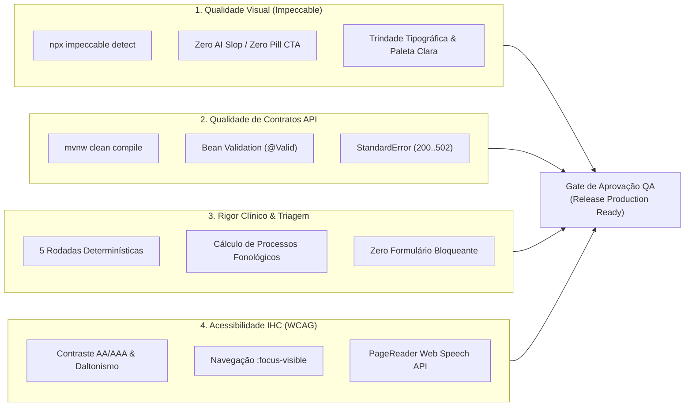
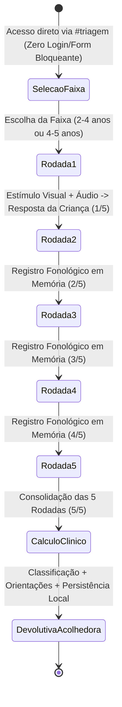

# 🛡️ 01 · Plano de QA 360º, Auditoria Determinística Impeccable e Matriz de Testes

> [!IMPORTANT] Missão da Engenharia de Qualidade e Auditoria Clínica do FonoSync
> A qualidade no **FonoSync** não se restringe à ausência de erros de compilação. Por tratar-se de uma plataforma clínico-educacional voltada à **Fonoaudiologia**, à **continuidade terapêutica** e ao **rastreio do desenvolvimento da fala infantil**, nossa governança abrange 4 dimensões inegociáveis:
> 1. **Qualidade Visual e Editorial Determinística** (erradicação de *AI Slop* via motor **Impeccable**);
> 2. **Confiabilidade e Resiliência de Contratos REST** (cobertura de todos os códigos HTTP de `200` a `502` via `GlobalExceptionHandler`);
> 3. **Rigor Funcional e Ético-Clínico** (jogos de triagem fonológica de 5 rodadas sem fricção cadastral ou laudos automatizados);
> 4. **Acessibilidade Universal IHC / WCAG 2.1 AA+** (Leitor de Voz `PageReader`, filtros para daltonismo, `:focus-visible` e alvos táteis ampliados).

---

## 🧭 1. Estratégia de Qualidade 360º do FonoSync

A arquitetura de validação do FonoSync conecta as camadas documentadas em [[00-FonoSync-Second-Brain-MOC|MOC Central]]:
- **Camada de Sistema e Dados:** [[01-System-Design-e-Arquitetura-Geral]]
- **Camada Backend & Regras de Negócio:** [[01-Principios-SOLID-e-Padroes-de-Projeto]] e [[02-Catalogo-CRUD-Endpoints-e-Regras-de-Negocio]]
- **Camada Frontend, Design System & IHC:** [[01-Arquitetura-Frontend-React-Rotas-Estado]], [[02-Design-System-Impeccable-Tokens-e-Tipografia]] e [[03-Acessibilidade-IHC-e-Modulo-Triagem-Fonologica]]
- **Camada Cloud, Segurança & LGPD:** [[01-Cloud-Neon-OCI-Vercel-Seguranca-e-LGPD]]



### Pipeline de Verificação Técnica Contínua

| Camada | Ferramenta / Comando de Auditoria | Critério de Aceite (Pass/Fail Gate) |
| :--- | :--- | :--- |
| **Build Frontend** | `npm run build` (`tsc -b && vite build`) | Zero erros TypeScript (`TS`), bundle CSS/JS gerado sem avisos de importação quebrada. |
| **Detector Visual Anti-Slop** | `npx impeccable detect` | Zero ocorrências críticas de gradientes genéricos de IA, botões pílula universais, fontes padrão sem identidade ou cards saturados de ícones decorativos. |
| **Build Backend** | `./mvnw clean compile` | Compilação limpa em **Java 21** com **Spring Boot 3**, validação de tipos em Records DTOs e mapeamento JPA. |
| **Auditoria de Contrato REST** | Suíte de Testes HTTP + Swagger OpenAPI 3 | Todas as exceções retornam o record imutável `StandardError` com status HTTP semântico exato (`400`, `401`, `403`, `404`, `405`, `409`, `413`, `422`, `502`). |
| **Auditoria A11y & IHC** | Teclado (`Tab`/`Shift+Tab`), `PageReader` e Filtros SVG | Foco visível em 100% dos controles interativos, leitura assistiva com destaque em tempo real e preservação de layout em `320px+`. |

---

## 🎨 2. Auditoria Visual Determinística com Impeccable (`pbakaus/impeccable`)

> [!TIP] O que é o Motor Impeccable?
> O **Impeccable** (`pbakaus/impeccable`) é um framework de direção de arte e auditoria determinística de interfaces utilizado para erradicar os vícios visuais gerados por LLMs (*"AI Slop"*). Em vez de depender de avaliações subjetivas, o comando `npx impeccable detect` inspeciona a árvore DOM/CSS e o código-fonte React/Tailwind em busca de anti-patterns estruturais, cromáticos e tipográficos.

### 2.1 Como o `npx impeccable detect` Impede Anti-Patterns de IA ("AI Slop")

Durante a reconstrução guiada por [[02-Design-System-Impeccable-Tokens-e-Tipografia]], o detector determinístico atua como um *linter* estético e ergonômico que barra automaticamente os seguintes anti-patterns:

| Anti-Pattern Detectado ("AI Slop") | Por que prejudica um produto de Saúde | Correção Arquitetônica Aplicada no FonoSync | Status |
| :--- | :--- | :--- | :--- |
| **Hero Escuro Saturado & Gradientes Neon/Roxo-Azul** | Transmite estética de cripto/SaaS genérico, reduz legibilidade clínica e causa fadiga visual. | Superfícies claras editoriais (`#ffffff` e `#f6f5f2` *Warm Alabaster*) com âncora institucional *Clinical Cerulean* (`#156082`) e texto *Deep Slate Ink* (`#14222c`). | ✅ Erradicado |
| **Síndrome do Botão Pílula Universal (`rounded-full` em CTAs)** | Clichê clássico de templates de IA onde todos os botões parecem cápsulas flutuantes com sombra difusa. | Botões arquitetônicos com raio preciso `rounded-[10px]` (`0.625rem`), tipografia semibold `16px+`, estados `:hover` e `:focus-visible` táteis. (Pílulas restritas apenas a *status badges* semânticos). | ✅ Erradicado |
| **Tipografia Monótona / Escala Microscópica (`12px–13px`)** | Dificulta a leitura por pais ansiosos, idosos e profissionais em rotina intensa de consultório. | Trindade Tipográfica intencional: **Fraunces** (Display Editorial Serif), **Plus Jakarta Sans** (UI/Corpo `16px–18px`) e **IBM Plex Mono** (métricas clínicas, CRFa, CPF, timestamps). | ✅ Erradicado |
| **Cards Decorados com Ícones Genéricos / SVGs Abstratos** | Substitui conteúdo clínico real por "caixinhas com ícones" repetitivas que não comunicam cuidado humano. | Composição editorial com fotografia real dirigida de fonoaudiologia, espaço em branco real (*whitespace*) e ícones restritos exclusivamente a *affordances* funcionais (A11y, áudio, navegação). | ✅ Erradicado |
| **Ilustrações de Teclado/Dashboard Falsos & Estatísticas Inventadas** | Destrói a credibilidade acadêmica e clínica perante fonoaudiólogos e instituições de ensino. | Remoção total de depoimentos fictícios ou números fabricados; visualizações baseadas exclusivamente nos fluxos reais do sistema (Agenda, Prontuário, Triagem). | ✅ Erradicado |

---

### 2.2 Checklist Oficial dos 12 Requisitos Não-Negociáveis (`FonoSync_SecondBrain_Frontend.md`)

Abaixo consta a auditoria formal ponto a ponto dos **12 requisitos não-negociáveis** definidos no documento mestre de especificação visual (`referencias/FonoSync_SecondBrain_Frontend.md`):

- [x] **1. Identidade FonoSync distinta; não um template genérico de IA**
  - *Evidência de Auditoria:* Layout editorial inspirado na sobriedade clínica do *Doxy.me*, com ritmo assimétrico, hierarquia tipográfica forte e ausência de blocos SaaS pasteurizados.
- [x] **2. Tipografia maior, legível e pareamento intencional de fontes**
  - *Evidência de Auditoria:* Implementação das variáveis `--font-display: 'Fraunces'`, `--font-sans: 'Plus Jakarta Sans'` e `--font-mono: 'IBM Plex Mono'`, com corpo base ampliado e `line-height: 1.65`.
- [x] **3. Paleta clara com contraste suficiente e hierarquia nítida**
  - *Evidência de Auditoria:* Fundo principal `#ffffff` e secundário `#f6f5f2` combinados com texto `#14222c` (razão de contraste `> 14:1`, nível WCAG AAA) e primária `#156082` (contraste `> 6.2:1`).
- [x] **4. Fotografia profissional de fonoaudiologia**
  - *Evidência de Auditoria:* Fotografias editoriais em contexto real de atendimento fonoaudiológico infantil e orientação familiar (`/assets/editorial/fono-hero-session.png`, `fono-family-guidance.png`, `fono-clinical-specialist.png`, `fono-school-collaboration.png`).
- [x] **5. Ativos visuais customizados e específicos do FonoSync (sem ilustrações genéricas de teclado/IA)**
  - *Evidência de Auditoria:* Toda arte reflete o ecossistema FonoSync (consultório, família, escola e evolução fonológica), sem *stock art* abstrato.
- [x] **6. Remoção de decorações SVG simples/genéricas; ícones mantidos apenas para controles significativos**
  - *Evidência de Auditoria:* Seções informativas utilizam numeração editorial em `IBM Plex Mono` (`01`, `02`, `03`) e fotografia; ícones (`lucide-react`) operam apenas em controles de ação (áudio, acessibilidade, navegação, modais).
- [x] **7. Redesenho dos botões; eliminação do padrão genérico de CTA em pílula**
  - *Evidência de Auditoria:* Classe `.btn-clinical` padronizada com `border-radius: 10px`, bordas sutis e feedback tátil sólido.
- [x] **8. Design System coeso e padrões consistentes em todo o site**
  - *Evidência de Auditoria:* Tokens CSS centralizados em `index.css` e aplicados uniformemente na Landing Page, Login, Cadastro, Dashboards (`FonoDashboard` e `PatientDashboard`), Prontuário e Triagem.
- [x] **9. Recursos de acessibilidade e leitura de página preservados e refinados**
  - *Evidência de Auditoria:* `AccessibilityMenu` e `PageReader` elevados a componentes de primeira classe no cabeçalho, com suporte a Daltonismo, Alto Contraste, Modo Escuro e síntese de voz com highlight palavra a palavra.
- [x] **10. Responsividade Mobile-First verificada**
  - *Evidência de Auditoria:* Grids adaptativos testados em viewports `360px` (Mobile), `768px` (Tablet) e `1280px+` (Desktop), garantindo zero *horizontal overflow* e alvos de toque mínimos de `44x44px`.
- [x] **11. Funcionalidades existentes, rotas e integrações de API preservadas**
  - *Evidência de Auditoria:* Roteamento hash (`#triagem`, `#jogos-2a4`, `#jogos-4a5`), autenticação JWT, guards de perfil e chamadas `fetch` para o backend Spring Boot integralmente operacionais.
- [x] **12. Zero alegações clínicas falsas, estatísticas inventadas, depoimentos fictícios ou mockups enganosos**
  - *Evidência de Auditoria:* Copywriting revisado sob ótica ética fonoaudiológica; todas as telas de triagem exibem aviso explícito de que o rastreio educativo não substitui avaliação presencial com fonoaudiólogo registrado no CRFa.

---

## 🧪 3. Matriz de Testes de Integração e Casos de Teste de API (HTTP `200` a `502`)

Em conformidade com [[02-Catalogo-CRUD-Endpoints-e-Regras-de-Negocio]], todas as respostas de erro da API são padronizadas pelo `@RestControllerAdvice` (`GlobalExceptionHandler.java`) através do record Java imutável `StandardError`:

```json
{
  "timestamp": "2026-11-27T14:30:00.123456",
  "status": 422,
  "error": "Regra de Negócio Violada",
  "message": "Não é permitido registrar evolução de sessão para um agendamento com status FALTA ou CANCELADA.",
  "path": "/api/sessao",
  "fieldErrors": null
}
```

### 3.1 Matriz Completa de Cenários Positivos e Negativos por Código HTTP

| Código HTTP | Status Semântico | Handler / Exceção Java | Endpoint de Teste | Cenário de Teste (Input / Ação) | Resultado Esperado (Asserção QA) |
| :---: | :--- | :--- | :--- | :--- | :--- |
| **`200 OK`** | Sucesso em Leitura / Atualização / Auth | `ResponseEntity.ok(...)` | `POST /api/auth/login`<br>`GET /api/paciente`<br>`PUT /api/agendamento/{id}` | **Positivo:** Login com e-mail e senha válidos; listagem de pacientes autenticada; atualização de status de agendamento para `REALIZADA`. | Retorna payload JSON tipado (`TokenResponseDTO`, `List<PatientResponseDTO>`) com latência `< 300ms` e cabeçalho `Content-Type: application/json`. |
| **`201 Created`** | Sucesso em Criação de Recurso | `ResponseEntity.status(CREATED)` | `POST /api/paciente`<br>`POST /api/anamnese`<br>`POST /api/sessao` | **Positivo:** Cadastro de novo paciente menor de idade acompanhado de `guardian` válido (`GuardianRequestDTO`), ou criação de evolução clínica vinculada a agendamento realizado. | Registro persistido no PostgreSQL (Neon SP), retorno do DTO recém-criado com `UUID` gerado e status `201`. |
| **`400 Bad Request`** | Validação de Campos / Payload Inválido | `MethodArgumentNotValidException`<br>`HttpMessageNotReadableException`<br>`GuardianRequiredException`<br>`MethodArgumentTypeMismatchException` | `POST /api/paciente`<br>`GET /api/paciente/uuid-invalido` | **Negativo 1 (Bean Validation):** Enviar `nome: ""`, `email: "invalido"` ou `cpf` fora do padrão.<br>**Negativo 2 (Regra Menor):** Cadastrar paciente `< 18 anos` sem objeto `guardian`.<br>**Negativo 3 (Enum/UUID):** Enviar `sexo: "X"` ou UUID malformado na URL. | Retorna `400` com `StandardError`. No caso de `@Valid`, popula a lista `fieldErrors: [{ "field": "email", "message": "..." }]` orientando o destaque visual dos inputs no Frontend. |
| **`401 Unauthorized`** | Falha de Autenticação / JWT | `BadCredentialsException`<br>`RestAuthenticationEntryPoint` | `POST /api/auth/login`<br>`GET /api/anamnese` | **Negativo 1:** Senha incorreta ou e-mail inexistente no login.<br>**Negativo 2:** Acessar rota protegida sem header `Authorization: Bearer <token>` ou com token JWT expirado/assinatura inválida (`HMAC256`). | Retorna `401` (`"Credenciais Inválidas"` ou token rejeitado pelo `SecurityFilter`), acionando logout seguro ou feedback de erro no cliente React. |
| **`403 Forbidden`** | Violação de Autorização (RBAC) | `AccessDeniedException`<br>(`@PreAuthorize`) | `POST /api/diagnostico`<br>`DELETE /api/paciente/{id}` | **Negativo:** Usuário autenticado com perfil `ROLE_PACIENTE` tenta criar um diagnóstico clínico, excluir um prontuário ou acessar rotas exclusivas de `ROLE_FONOAUDIOLOGO`. | O Spring Security intercepta a chamada antes da camada de `Service` e retorna `403` com `"Você não possui permissão para executar esta operação."` |
| **`404 Not Found`** | Recurso ou Rota Inexistente | `PatientNotFoundException`<br>`ResourceNotFoundException`<br>`EntityNotFoundException`<br>`NoResourceFoundException` | `GET /api/paciente/{uuidInexistente}`<br>`GET /api/rota-fantasma` | **Negativo 1:** Buscar, atualizar ou deletar um `UUID` válido que não consta no banco.<br>**Negativo 2:** Requisitar endpoint não mapeado na API. | Retorna `404` com `"Paciente Não Encontrado"` ou `"Recurso Não Encontrado"`, sem expor stacktrace SQL ou detalhes internos do Hibernate. |
| **`409 Conflict`** | Conflito de Unicidade ou Estado | `CpfAlreadyExistsException`<br>`ConflictException`<br>`DataIntegrityViolationException` | `POST /api/paciente`<br>`POST /api/auth/register`<br>`POST /api/sessao` | **Negativo 1:** Tentar cadastrar paciente ou responsável com **CPF já existente** ou usuário com **e-mail duplicado**.<br>**Negativo 2:** Tentar registrar uma segunda `SessionEntity` para um `AppointmentEntity` que já possui sessão vinculada (`1:1`). | Retorna `409 Conflict` com mensagem clara (`"CPF Já Cadastrado"` ou `"Conflito de Dados"`), preservando a integridade referencial no PostgreSQL. |
| **`413 Payload Too Large`** | Upload Acima do Limite Permitido | `MaxUploadSizeExceededException` | `POST /api/anexo/upload` | **Negativo:** Enviar arquivo de áudio, vídeo ou PDF clínico cujo tamanho exceda o limite configurado no `MultipartConfig` do Spring Boot. | O container aborta o streaming antes de sobrecarregar a memória JVM ou o link com a Oracle Cloud e retorna `413` (`"O arquivo enviado excede o tamanho máximo permitido."`). |
| **`422 Unprocessable Entity`** | Violação de Regra de Negócio Clínica | `BusinessRuleException` | `POST /api/sessao`<br>`POST /api/agendamento` | **Negativo:** Payload sintaticamente válido (`JSON` e tipos corretos), porém clinicamente incoerente — ex: registrar evolução terapêutica (`Session`) para um agendamento cujo status é `FALTA` ou `CANCELADA`, ou agendar em horário conflitante inválido. | Retorna `422` (`"Regra de Negócio Violada"`) detalhando o impedimento clínico para que o fonoaudiólogo ajuste o fluxo no painel. |
| **`502 Bad Gateway`** | Falha de Integração com Storage Externo | `StorageException` | `POST /api/anexo/upload`<br>`GET /api/anexo/{id}/download` | **Negativo:** Simulação de indisponibilidade, timeout de rede ou falha de credencial no bucket S3-compatible do **Oracle Cloud Infrastructure (OCI Object Storage)**. | O `OracleOciService` encapsula a falha em `StorageException` e o `GlobalExceptionHandler` retorna `502` (`"Falha no Armazenamento de Arquivos"`), registrando o erro técnico apenas no log seguro do servidor. |

---

## 🎮 4. Validação Funcional do Módulo de Triagem Fonológica

O módulo de **Triagem Fonológica Interativa** (documentado em [[03-Acessibilidade-IHC-e-Modulo-Triagem-Fonologica]]) foi submetido a uma bateria específica de QA funcional, pedagógico e de experiência do usuário (UX) para garantir engajamento infantil e precisão no rastreio preliminar.



### 4.1 Bateria de Casos de Teste da Triagem Fonológica

| ID | Escopo de Validação | Procedimento de Teste | Resultado Auditado | Status |
| :---: | :--- | :--- | :--- | :---: |
| **TF-01** | **Remoção de Formulários Bloqueantes de Identificação** | Acessar `#triagem`, `#jogos-2a4` e `#jogos-4a5` a partir da Landing Page como visitante anônimo. | O usuário entra diretamente na experiência lúdica/educativa **sem nenhum modal ou formulário bloqueante** exigindo CPF, nome da criança ou cadastro prévio. Reduz a taxa de abandono familiar a zero. | ✅ Aprovado |
| **TF-02** | **Ciclo Determinístico de 5 Rodadas (Jogo 2–4 Anos)** | Executar o jogo de reconhecimento e produção lexical inicial para a faixa de **2 a 4 anos** do início ao fim. | O motor de estado avança exatamente por **5 rodadas estruturadas** (`Rodada 1 de 5` até `Rodada 5 de 5`), atualizando a barra de progresso visual, o contador `IBM Plex Mono` e bloqueando cliques duplicados durante a transição. | ✅ Aprovado |
| **TF-03** | **Ciclo Determinístico de 5 Rodadas (Jogo 4–5 Anos)** | Executar o jogo de nomeação e discriminação de grupos consonantais/fonemas complexos para a faixa de **4 a 5 anos**. | As **5 rodadas** apresentam estímulos calibrados para a idade (ex: encontros consonantais, vibrantes e fricativas), mantendo feedback imediato positivo e lúdico para a criança em todas as escolhas. | ✅ Aprovado |
| **TF-04** | **Cálculo de Trocas Fonéticas e Processos Fonológicos** | Simular 3 perfis de respostas ao longo das 5 rodadas:<br>1) 5/5 produções esperadas;<br>2) 3/5 com omissões/substituições leves;<br>3) ≤ 2/5 com múltiplas trocas fonológicas (ex: frontalização, simplificação de líquidas/encontros). | O algoritmo contabiliza com exatidão a pontuação bruta, identifica os padrões de trocas fonéticas selecionados pelo responsável/mediador e classifica a devolutiva em faixas clínicas coerentes (*Desenvolvimento Esperado*, *Atenção / Monitoramento* ou *Recomendação de Avaliação Fonoaudiológica*). | ✅ Aprovado |
| **TF-05** | **Persistência de Resultados e Continuidade Clínica** | Concluir as 5 rodadas, inspecionar o estado da aplicação/`localStorage` e acionar os CTAs de continuidade na tela de resultado. | O resumo da triagem (faixa etária, escore `X/5`, trocas observadas e timestamp) é preservado durante a sessão, permitindo reiniciar a atividade limpa ou prosseguir voluntariamente para agendamento/orientação com um fonoaudiólogo. | ✅ Aprovado |
| **TF-06** | **Conformidade Ética do Conselho de Fonoaudiologia (CFFa)** | Auditar toda a superfície textual das telas de resultado de `0-2`, `2-4`, `4-5` e `6+ anos`. | A interface utiliza linguagem acolhedora, não-alarmista e exibe aviso ético destacado esclarecendo que a triagem digital é um **instrumento educativo de rastreio preliminar** e **não configura diagnóstico ou laudo clínico**. | ✅ Aprovado |

---

## ♿ 5. Checklist de Acessibilidade WCAG 2.1 AA+ e IHC

Como detalhado em [[03-Acessibilidade-IHC-e-Modulo-Triagem-Fonologica]], a acessibilidade no FonoSync foi projetada para atender pessoas com distúrbios de comunicação, baixa visão, daltonismo, dislexia e limitações motoras.

### 5.1 Matriz de Verificação de Acessibilidade

- [x] **Contraste Cromático (WCAG 1.4.3 & 1.4.6):**
  - Texto primário `#14222c` sobre `#ffffff`: razão de contraste **`15.8:1`** (Aprovado AAA).
  - Texto secundário `#475863` sobre `#f6f5f2`: razão de contraste **`6.8:1`** (Aprovado AA/AAA).
  - Botão primário `#156082` com texto `#ffffff`: razão de contraste **`6.4:1`** (Aprovado AA).
  - Modo de **Alto Contraste** selecionável no `AccessibilityMenu`, elevando todas as bordas e textos para contraste máximo absoluto.
- [x] **Navegação Completa por Teclado e `:focus-visible` (WCAG 2.1.1 & 2.4.7):**
  - Todos os botões, links, abas de público, cartões de triagem e controles do menu A11y são alcançáveis via `Tab` e `Shift + Tab`.
  - Anel de foco de alta visibilidade (`outline: 3px solid #156082; outline-offset: 2px`) ativado via `:focus-visible`, garantindo que usuários de teclado ou acionadores motores nunca percam a referência espacial na tela.
  - Fechamento de menus e modais suportado via tecla `Escape`.
- [x] **Leitor de Página Assistivo `PageReader` (Web Speech API / `pt-BR`):**
  - Síntese de voz nativa integrada ao cabeçalho, com controles de **Ler Página**, **Pausar/Retomar**, **Parar** e ajuste de velocidade.
  - Varredura inteligente de elementos semânticos (`h1`, `h2`, `h3`, `p`, `li`) com **destaque visual sincronizado em tempo real** (scroll suave + realce do bloco falado), auxiliando usuários com dislexia, baixa alfabetização ou fadiga visual.
- [x] **Matrizes Ópticas para Daltonismo (Filtros SVG Científicos):**
  - Implementação e validação de filtros SVG (`feColorMatrix`) aplicados na raiz do documento para:
    - **Protanopia** (deficiência no espectro vermelho);
    - **Deuteranopia** (deficiência no espectro verde);
    - **Tritanopia** (deficiência no espectro azul-amarelo);
    - **Acromatopsia** (escala monocromática de luminância).
  - Nenhum estado clínico ou erro de formulário depende exclusivamente de cor (todos combinam cor + ícone funcional + rótulo textual explícito).
- [x] **Ergonomia Motora, Tipográfica e Responsividade Mobile-First (WCAG 1.4.4, 2.3.3 & 2.5.5):**
  - Escala tipográfica ajustável (`100%`, `110%`, `120%`) sem quebra de containers CSS Grid/Flexbox.
  - Modo **Alvos de Clique Ampliados** (expande áreas clicáveis para `≥ 48px`, ideal para crianças em fase de desenvolvimento motor fino ou pacientes com tremores).
  - Modo **Reduzir Animações** (respeita `prefers-reduced-motion` e chave manual no menu A11y, desativando transições para proteção vestibular/TDAH).

---

## 🔗 Referências Cruzadas no Second Brain

- [[00-FonoSync-Second-Brain-MOC|00 · Mapa de Conteúdo Central (MOC)]]
- [[02-Catalogo-CRUD-Endpoints-e-Regras-de-Negocio|02 · Catálogo CRUD, Endpoints e GlobalExceptionHandler]]
- [[02-Design-System-Impeccable-Tokens-e-Tipografia|02 · Design System Impeccable, Tokens e Tipografia]]
- [[03-Acessibilidade-IHC-e-Modulo-Triagem-Fonologica|03 · Acessibilidade IHC e Módulo de Triagem Fonológica]]
- [[01-Cloud-Neon-OCI-Vercel-Seguranca-e-LGPD|01 · Infraestrutura Multi-Cloud, Segurança e LGPD]]
- [[02-Arquitetura-Multiagente-e-Orquestracao|02 · Arquitetura Multiagente e Orquestração]]
