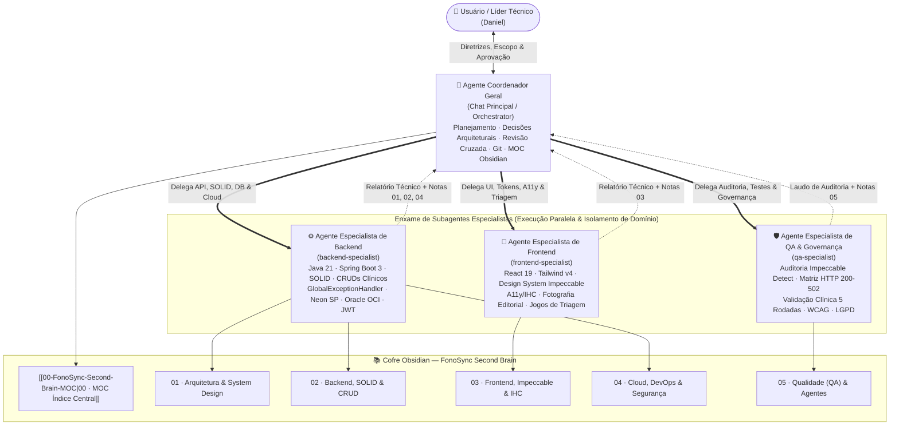
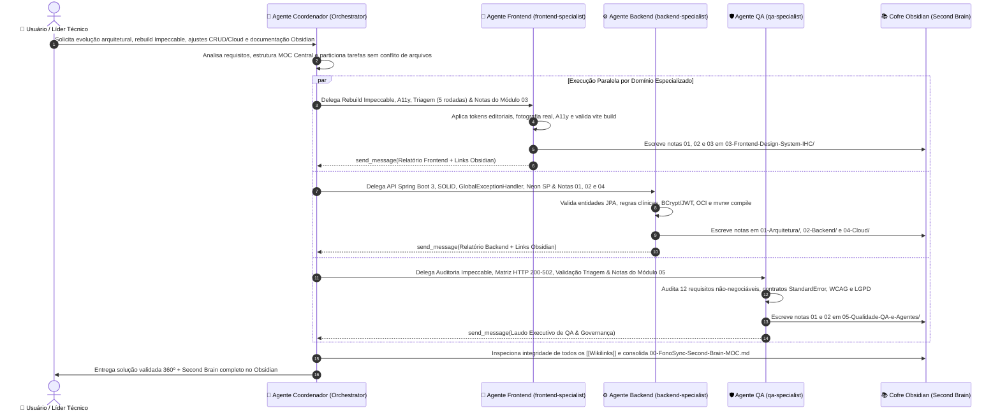

# 🤖 02 · Arquitetura Multiagente e Orquestração do Ecossistema FonoSync

> [!IMPORTANT] Engenharia de Software Assistida por Enxame de Agentes Especialistas
> O desenvolvimento, a reconstrução visual **Impeccable**, a blindagem do backend **Spring Boot 3 / Java 21** e a curadoria deste **Second Brain no Obsidian** são operados por uma **Arquitetura Multiagente Hierárquica**.
> Sob o comando central do **Agente Coordenador (`coordinator`)**, três subagentes especialistas autônomos (**Frontend**, **Backend** e **QA/Governança**) atuam em paralelo com fronteiras estritas de responsabilidade, evitando regressões cruzadas e garantindo rastreabilidade total.

---

## 🏛️ 1. Topologia da Arquitetura de Agentes

A topologia segue o padrão **Hub-and-Spoke Orchestrator** (Orquestrador Central com Subagentes Especializados por Domínio), onde o **Coordenador Geral** detém a visão holística do produto e delega pacotes de trabalho atômicos para os agentes especialistas:

---

## 🧩 2. Papéis, Responsabilidades, Ferramentas e Fronteiras de Atuação

Para impedir que alterações estéticas quebrem contratos de API ou que refatorações de banco afetem a experiência lúdica infantil, cada agente opera sob um contrato rigoroso de escopo:

### 2.1 Coordenador Geral (`coordinator` — Chat Principal / Orchestrator)

- **Missão Principal:** Orquestrar o ciclo de vida completo das entregas do FonoSync, traduzindo os requisitos clínicos, acadêmicos e de produto do usuário em planos de execução paralelos para os subagentes.
- **Responsabilidades Nucleares:**
  - **Planejamento e Tomada de Decisão Arquitetural:** Definir contratos entre Frontend e Backend, topologia multi-cloud (Vercel + Neon São Paulo + Oracle OCI) e estrutura do cofre Obsidian.
  - **Orquestração e Delegação Assíncrona:** Instanciar `frontend-specialist`, `backend-specialist` e `qa-specialist` com contextos cirúrgicos e consolidar seus relatórios via barramento de mensagens.
  - **Revisão Cruzada e Resolução de Conflitos:** Validar se os DTOs do Backend correspondem exatamente aos tipos TypeScript do Frontend e se todos os `[[Wikilinks]]` do Second Brain estão íntegros.
  - **Sincronização Git e Gestão de Releases:** Controlar branches, commits semânticos, pushes para os repositórios e curadoria do [[00-FonoSync-Second-Brain-MOC|MOC Central]].
- **Fronteira de Atuação (Boundary):** Não executa reescritas massivas isoladas sem acionar a validação especialista e o gate de QA.

---

### 2.2 Agente Especialista de Frontend (`frontend-specialist`)

- **Missão Principal:** Construir e manter uma interface clínica, humana, acolhedora e acessível em **React 19 + TypeScript + Tailwind CSS v4**, seguindo estritamente o brief `FonoSync_SecondBrain_Frontend.md` e a inspiração editorial do **Doxy.me**.
- **Responsabilidades Nucleares:**
  - **Design System Impeccable:** Manutenção da trindade tipográfica (`Fraunces`, `Plus Jakarta Sans`, `IBM Plex Mono`), paleta clara (`#ffffff`, `#f6f5f2`, `#156082`, `#14222c`, `#b86a52`) e botões arquitetônicos `rounded-[10px]`.
  - **Direção de Fotografia Editorial e Ativos Visuais:** Curadoria de imagens reais de fonoaudiologia em consultório, família e escola, eliminando SVGs decorativos genéricos.
  - **Acessibilidade Nativa (A11y) e IHC:** Evolução do `AccessibilityMenu` (filtros ópticos SVG para Protanopia, Deuteranopia, Tritanopia e Acromatopsia; Alto Contraste; Modo Escuro; Alvos Ampliados; Redução de Movimento) e do `PageReader` (Web Speech API com destaque sincronizado).
  - **Módulo de Triagem Fonológica e Jogos Terapêuticos:** Implementação dos fluxos de rastreio por faixa etária (`0–2`, `2–4`, `4–5` e `6+ anos`) com ciclo de 5 rodadas, remoção de formulários bloqueantes e devolutiva ética acolhedora.
- **Documentação Sob Sua Custódia:**
  - [[01-Arquitetura-Frontend-React-Rotas-Estado]]
  - [[02-Design-System-Impeccable-Tokens-e-Tipografia]]
  - [[03-Acessibilidade-IHC-e-Modulo-Triagem-Fonologica]]
- **Fronteira de Atuação (Boundary):** Proibido alterar regras de negócio do servidor Java, schemas SQL, endpoints REST ou contratos de autenticação JWT sem autorização expressa do Coordenador.

---

### 2.3 Agente Especialista de Backend (`backend-specialist`)

- **Missão Principal:** Projetar, implementar e blindar a API RESTful do FonoSync em **Java 21 + Spring Boot 3**, garantindo aderência aos **Princípios SOLID**, integridade relacional e segurança de dados clínicos sensíveis.
- **Responsabilidades Nucleares:**
  - **Arquitetura Orientada a Domínio e SOLID:** Organização modular por pacotes de domínio (`patient`, `guardian`, `professional`, `anamnesis`, `evaluation`, `diagnostic`, `appointment`, `session`, `attachment`, `security`, `infra`) com aplicação rigorosa de SRP, OCP, LSP, ISP e DIP.
  - **Catálogo de CRUDs Clínicos e Regras de Negócio:** Validação obrigatória de responsável (`GuardianEntity`) para pacientes menores de idade, unicidade de CPF/e-mail, máquina de estados de agendamentos (`StatusSessao`) e vínculo com evolução terapêutica (`SessionEntity`).
  - **Tratamento Global de Exceções (`GlobalExceptionHandler`):** Mapeamento exaustivo de falhas para o record imutável `StandardError` (`400`, `401`, `403`, `404`, `405`, `409`, `413`, `422`, `502`).
  - **Persistência e Multi-Cloud:** Integração JPA/Hibernate com **PostgreSQL Serverless no Neon (`aws-sa-east-1` — São Paulo)**, armazenamento binário no **Oracle Cloud Infrastructure (OCI Object Storage)** e segurança **Spring Security + JWT (`HMAC256`) + BCrypt**.
- **Documentação Sob Sua Custódia:**
  - [[01-System-Design-e-Arquitetura-Geral]]
  - [[01-Principios-SOLID-e-Padroes-de-Projeto]]
  - [[02-Catalogo-CRUD-Endpoints-e-Regras-de-Negocio]]
  - [[01-Cloud-Neon-OCI-Vercel-Seguranca-e-LGPD]]
- **Fronteira de Atuação (Boundary):** Proibido modificar estilos CSS, componentes visuais React ou tokens do Design System no repositório Frontend.

---

### 2.4 Agente Especialista de QA, Governança & Auditoria Clínica (`qa-specialist`)

- **Missão Principal:** Atuar como guardião independente da qualidade ponta a ponta, auditando determinismo visual, integridade de builds, contratos HTTP, precisão clínica dos jogos de triagem, acessibilidade WCAG e conformidade com a LGPD.
- **Responsabilidades Nucleares:**
  - **Auditoria Determinística `impeccable detect`:** Varredura anti-slop para assegurar cumprimento integral dos 12 requisitos não-negociáveis do `FonoSync_SecondBrain_Frontend.md`.
  - **Validação de Compilação e Build:** Verificação de `vite build` / `tsc -b` no Frontend e `mvnw clean compile` no Backend Java 21.
  - **Testes de Contrato REST e Resiliência:** Execução e documentação da matriz de testes cobrindo cenários positivos e negativos de todos os códigos HTTP (`200` a `502`).
  - **Auditoria Clínica, Acessibilidade e LGPD:** Verificação das 5 rodadas dos jogos fonológicos (`2–4` e `4–5 anos`), testes de teclado/`:focus-visible`/`PageReader` e validação da política de proteção de dados sensíveis de saúde (Art. 11 da LGPD).
- **Documentação Sob Sua Custódia:**
  - [[01-Plano-de-QA-Auditoria-Impeccable-e-Testes]]
  - [[02-Arquitetura-Multiagente-e-Orquestracao]]
- **Fronteira de Atuação (Boundary):** Atua com independência de auditoria; qualquer desvio detectado bloqueia o gate de entrega e é reportado diretamente ao Coordenador para correção pelo especialista responsável.

---

### 2.5 Matriz Consolidada de Governança Multiagente (RACI)

| Atividade / Entregável | Coordenador (`coordinator`) | Frontend (`frontend-specialist`) | Backend (`backend-specialist`) | QA (`qa-specialist`) |
| :--- | :---: | :---: | :---: | :---: |
| **Decisão Arquitetural & Sincronização Git** | **R / A** | C | C | I |
| **Design System Impeccable & UI React 19** | A | **R** | I | C (Audita) |
| **Acessibilidade IHC, Daltonismo & `PageReader`** | A | **R** | I | C (Audita) |
| **Jogos de Triagem Fonológica (5 Rodadas)** | A | **R** | I | C (Valida) |
| **API Spring Boot 3, SOLID & CRUDs Clínicos** | A | I | **R** | C (Testa) |
| **Neon PostgreSQL (SP), Oracle OCI & JWT/BCrypt** | A | I | **R** | C (Audita LGPD) |
| **Auditoria `npx impeccable detect` & Matriz QA** | A | C | C | **R** |
| **Curadoria do Second Brain no Obsidian** | **A** | **R** (Módulo 03) | **R** (Módulos 01, 02, 04) | **R** (Módulo 05) |

*(Legenda: **R** = Responsible / Executor · **A** = Accountable / Aprovador · **C** = Consulted / Revisor · **I** = Informed)*

---

## 🔄 3. Diagrama de Sequência e Fluxo de Colaboração Multiagente

O diagrama abaixo ilustra o protocolo completo de comunicação assíncrona entre o **Coordenador** e os **3 Subagentes Especialistas** durante um ciclo de engenharia e atualização do Second Brain:

---

## 📈 4. Protocolo de Evolução Contínua do Second Brain no Obsidian

Para que o cofre `fonosync_obsidian` permaneça como uma fonte viva da verdade (*Single Source of Truth*) e nunca se torne documentação obsoleta, todo o time multiagente segue o **Protocolo de Evolução Contínua em 5 Regras**:

> [!NOTE] As 5 Regras de Ouro da Governança do Second Brain
> 1. **Sincronia Código-Conhecimento (Code-to-Note Parity):** Nenhuma alteração em entidade JPA (`UserEntity`, `PatientEntity`, `GuardianEntity`), endpoint REST, código HTTP no `GlobalExceptionHandler` ou token CSS do Design System Impeccable é considerada concluída sem a atualização simultânea da nota correspondente no Obsidian.
> 2. **Padronização de Metadados YAML Frontmatter:** Toda nota deve iniciar com bloco YAML estruturado contendo `title`, `tags` hierárquicas (`fonosync`, domínio específico), `created`, `updated`, `status` e `author` (identificador do agente responsável).
> 3. **Malha Densa de `[[Wikilinks]]` Bidirecionais:** Nenhuma nota pode ficar órfã no grafo do Obsidian (`Graph View`). Toda nota técnica deve referenciar o [[00-FonoSync-Second-Brain-MOC|MOC Central]] e conectar-se às notas correlatas de outros agentes (ex: uma regra de erro `422` no Backend conecta-se ao teste de contrato no QA e ao tratamento de estado no Frontend).
> 4. **Visualização Arquitetural via Mermaid Nativo:** Fluxos de autenticação, modelagem relacional (DER), topologia C4, estados de jogos de triagem e orquestração de agentes devem ser expressos via diagramas `mermaid` renderizáveis nativamente no Obsidian.
> 5. **Auditoria de Gate pelo Agente de QA:** Antes de encerrar qualquer marco do Projeto Integrador, o `qa-specialist` verifica se os checklists não-negociáveis, matrizes de teste e diretrizes ético-clínicas (CFFa e LGPD) refletem fielmente o estado real dos repositórios `fonosync` (Frontend) e `fonosync-api` (Backend).

---

## ✅ Checklist de Governança da Arquitetura Multiagente

- [x] **Orquestração Centralizada:** `coordinator` gerencia o índice mestre [[00-FonoSync-Second-Brain-MOC]] e a integração entre repositórios.
- [x] **Isolamento de Domínio Frontend:** `frontend-specialist` mantém 100% de conformidade com o Design System Impeccable e acessibilidade IHC.
- [x] **Isolamento de Domínio Backend:** `backend-specialist` garante princípios SOLID, integridade JPA no Neon (São Paulo) e cobertura de erros no `GlobalExceptionHandler`.
- [x] **Auditoria Independente de QA:** `qa-specialist` certifica o produto contra *AI Slop*, quebras de contrato REST, falhas de acessibilidade e riscos de LGPD.
- [x] **Grafo Obsidian 100% Conectado:** Todos os 5 módulos temáticos interligados sem links quebrados.

---

## 🔗 Referências Cruzadas no Second Brain

- [[00-FonoSync-Second-Brain-MOC|00 · Mapa de Conteúdo Central (MOC)]]
- [[01-System-Design-e-Arquitetura-Geral|01 · System Design, C4 Model e DER]]
- [[01-Principios-SOLID-e-Padroes-de-Projeto|01 · Princípios SOLID e Padrões de Projeto]]
- [[02-Catalogo-CRUD-Endpoints-e-Regras-de-Negocio|02 · Catálogo CRUD, Endpoints e Regras de Negócio]]
- [[01-Arquitetura-Frontend-React-Rotas-Estado|01 · Arquitetura Frontend React 19, Rotas e Estado]]
- [[02-Design-System-Impeccable-Tokens-e-Tipografia|02 · Design System Impeccable, Tokens e Tipografia]]
- [[03-Acessibilidade-IHC-e-Modulo-Triagem-Fonologica|03 · Acessibilidade IHC e Módulo de Triagem Fonológica]]
- [[01-Cloud-Neon-OCI-Vercel-Seguranca-e-LGPD|01 · Infraestrutura Multi-Cloud, Segurança e LGPD]]
- [[01-Plano-de-QA-Auditoria-Impeccable-e-Testes|01 · Plano de QA 360º, Auditoria Impeccable e Matriz de Testes]]
