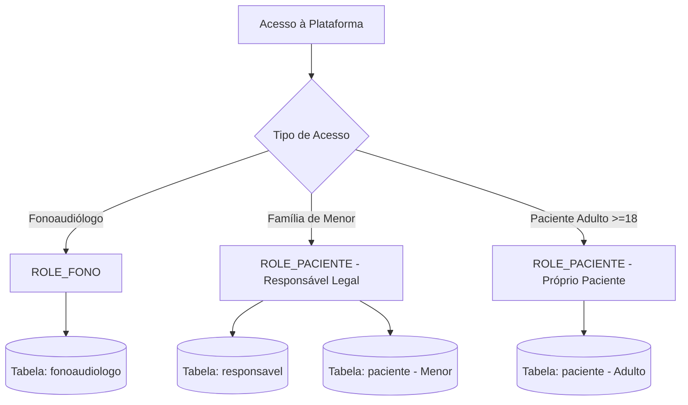

# Guia de Referência Técnica e Arquitetural do Front-End (FonoSync)

> **Documento Oficial de Engenharia, Regras de Negócio e Conformidade LGPD**  
> **Projeto Integrador — Fatec Ferraz de Vasconcelos**  
> **Data:** Novembro de 2026

---

## 1. Visão Geral da Arquitetura Front-End

O front-end do **FonoSync** é uma Single-Page Application (SPA) desenvolvida com:
* **React 19** com componentes funcionais e Hooks modernos.
* **Vite** para empacotamento ultrarrápido e Hot Module Replacement (HMR).
* **Tailwind CSS** para estilização utilitária consistente e responsiva.
* **Lucide React** para iconografia semântica e acessível.
* **Roteamento Hash (`#/`)** nativo e resiliente para execução local e em servidores estáticos sem dependência de reescrita de rotas HTTP.

---

## 2. Política Estrita de Privacidade e LGPD para Menores de Idade

Em conformidade rigorosa com a **Lei Geral de Proteção de Dados (Lei nº 13.709/2018 - Art. 14)** e o **Estatuto da Criança e do Adolescente (ECA)**, o front-end do FonoSync adota o princípio de **Minimização de Dados (Privacy by Design & by Default)**:

### ⚠️ Regras Mandatórias:
1. **Nenhum Dado Sensível ou Frágil de Menor (como CPF) é Solicitado:**
   * Crianças e adolescentes menores de 18 anos **NÃO** têm campo de CPF em nenhuma tela de auto-cadastro ou de triagem pública.
   * O único documento de identificação fiscal registrado no sistema é o **CPF do Responsável Legal** (pai, mãe ou tutor legal adulto).
2. **Dados Permitidos da Criança no Cadastro e Prontuário:**
   * **Nome Completo** (para identificação no prontuário clínico).
   * **Data de Nascimento** (estritamente necessária para calcular a idade e calibrar a faixa etária dos jogos fonoaudiológicos e protocolos de triagem).
   * **Sexo Biológico** (relevante clinicamente para tabelas de desenvolvimento fonético e parâmetros acústicos da voz).
3. **Representação Jurídica do Menor:**
   * Qualquer paciente com idade calculada inferior a 18 anos (`idade < 18`) é categorizado como dependente e **obrigatoriamente vinculado ao Responsável Legal** (`GuardianEntity`), que responde pelo consentimento de tratamento de dados.

---

## 3. Mapeamento de Perfis de Usuário e Fluxos de Cadastro

O sistema atende a três cenários reais de uso, refletidos tanto no banco de dados quanto na interface:



### 3.1. Fonoaudiólogo(a) (`ROLE_FONO`)
* **Entidades no Back-end:** `usuario` + `fonoaudiologo`.
* **Campos Obrigatórios:**
  * Nome Completo (`nome`)
  * Registro Profissional CRFa (`crfa`, ex: `CRFa 2-19842`)
  * Especialidade Clínica (`especialidade`, ex: *Linguagem e Fala Infantil*, *Audiologia*, *Motricidade Orofacial*, *Voz*)
  * Telefone / WhatsApp (`telefone`)
  * E-mail Profissional (`email`)
  * Senha de Acesso Criptografada (`senha`)
* **Direcionamento pós-login:** `#/profissional/dashboard`.

### 3.2. Responsável Familiar por Menor de Idade (`ROLE_PACIENTE`)
* **Entidades no Back-end:** `usuario` + `responsavel` + `paciente` (dependente em pré-cadastro).
* **Campos do Responsável Legal:**
  * Nome do Responsável (`nome`)
  * CPF do Responsável (`cpf`, com máscara `000.000.000-00`)
  * Telefone / Contato (`telefone`)
  * Grau de Parentesco (`grau_parentesco`: Mãe, Pai, Avô/Avó, Tutor(a) Legal, Outro)
* **Campos do Dependente (Menor):**
  * Nome Completo da Criança (`nome_paciente`)
  * Data de Nascimento (`data_nascimento` - validação automática `< 18 anos`)
  * Sexo Biológico (`sexo`: Masculino, Feminino, Outro)
  * *Observação:* CPF do menor é omitido (`null`) em conformidade com a LGPD.
* **Direcionamento pós-login:** `#/paciente/inicio`.

### 3.3. Próprio Paciente Adulto ($\ge 18$ anos) (`ROLE_PACIENTE`)
* **Entidades no Back-end:** `usuario` + `paciente` (independente, sem responsável).
* **Campos:** Nome Completo, Data de Nascimento ($\ge 18$ anos), CPF próprio, Telefone/WhatsApp, Sexo, E-mail e Senha.
* **Direcionamento pós-login:** `#/paciente/inicio`.

### 3.4. Autenticação Social via Google
* Botão com identidade visual oficial multicolorida do Google.
* Integrado tanto na tela de Login quanto de Cadastro.
* Suporte a login rápido de demonstração e integração OAuth com contas Google Workspace.

---

## 4. Prontuário Clínico Eletrônico com Abas

Implementado no componente `PatientRecordModal.jsx`, o prontuário clínico substitui a antiga visualização estática por um sistema completo com 5 abas operacionais:

| Aba | Descrição | Endpoints Consumidos | Ações Disponíveis |
| :--- | :--- | :--- | :--- |
| **1. Visão Geral** | Dados demográficos, idade calculada, status clínico e dados do **Responsável Legal** | `GET /api/guardians/{id}` | Edição cadastral, arquivamento e exclusão |
| **2. Anamnese** | Queixa principal, início dos sintomas, histórico familiar, desenvolvimento da fala e observações | `GET /api/anamnesis/patient/{id}`<br>`POST /api/anamnesis/register/{id}` | Visualização do histórico e registro de nova anamnese |
| **3. Diagnóstico** | CID-10, diagnóstico fonoaudiológico, área terapêutica, frequência de sessões e plano de metas | `GET /api/diagnostic/patient/{id}`<br>`POST /api/diagnostic/register/{id}` | Definição e atualização de diagnóstico com código CID-10 |
| **4. Avaliações** | Registro de sessões, triagem fonoaudiológica, resultados observados e condutas propostas | `GET /api/evaluation/patient/{id}`<br>`POST /api/evaluation/register/{id}` | Histórico cronológico e inserção de nova avaliação clínica |
| **5. Anexos & Exames** | Laudos médicos, audiometrias, exames em PDF, imagens e gravações de áudio | `GET /api/attachments/patient/{id}`<br>`POST /api/attachments/upload`<br>`GET /api/attachments/{id}/download` | Download de laudos e upload com `FormData` (`multipart/form-data`) |

---

## 5. Padrões de Design de UI/UX e Acessibilidade

O design segue os princípios **UI/UX Pro Max** e conformidade com **WCAG 2.1 nível AA**:

### 5.1. Paleta de Cores Institucional
* **Navy Clínico (`#172C3A`):** Títulos principais, elementos de cabeçalho e serifa de alta autoridade médica.
* **Primary Sky (`#0284C7`):** Ações primárias, links, botões principais e elementos ativos.
* **Canvas (`#F8FAFC`):** Plano de fundo calmo e com redução de fadiga visual.
* **Surface (`#FFFFFF`):** Cartões clínicos, modais e containers de dados.
* **Bordas (`#E2E8F0`):** Linhas suaves que organizam os dados sem poluição visual.
* **Status Badges:**
  * Verde (`#059669` / `#ECFDF5`): Em acompanhamento / Concluído.
  * Âmbar (`#D97706` / `#FFFBEB`): Arquivado / Pendência.
  * Azul (`#0284C7` / `#E0F2FE`): Pré-cadastro.

### 5.2. Acessibilidade Integrada (A11y)
* **Leitor de Tela por Voz Integrado (`PageReader` / Web Speech API):** Permite que pessoas com deficiência visual ou baixa alfabetização escutem todo o conteúdo da tela.
* **Painel de Acessibilidade (`A11yModal`):**
  * Ajuste de tamanho de fonte (+ / -).
  * Alto contraste (fundo escuro com texto de alto contraste).
  * Fonte amigável para dislexia (*OpenDyslexic*).
  * Destaque visual de leitura.
* **Atributos Semânticos:** Uso rigoroso de `aria-label`, `aria-pressed`, `aria-invalid`, `role="status"` e `role="alert"`.

---

## 6. Estrutura de Arquivos e Serviços do Front-End

```text
fonosync/
├── referencia/
│   └── GUIA_REFERENCIA_FRONTEND.md        # Este documento de referência
├── src/
│   ├── assets/images/                    # Identidade visual e logotipo
│   ├── components/                       # Componentes reutilizáveis (A11yModal, Notice, Button)
│   ├── context/                          # AuthContext (sessão e tokens JWT) e A11yContext
│   ├── hooks/                            # useAuth, useA11y, useHashRoute
│   ├── pages/
│   │   ├── AccessArea.jsx                # Tela de Login e Cadastro (3 perfis + Google)
│   │   ├── LandingPage.jsx               # Página inicial institucional
│   │   ├── PatientDashboard.jsx          # Portal da Família / Paciente
│   │   ├── ProfessionalDashboard.jsx     # Painel principal do Fonoaudiólogo
│   │   └── professional/
│   │       ├── Patients.jsx              # Tabela de Pacientes e filtros
│   │       ├── PatientRecordModal.jsx    # Prontuário Clínico Eletrônico com 5 abas
│   │       ├── Schedule.jsx              # Agenda de consultas
│   │       ├── Tracking.jsx              # Acompanhamento de exercícios
│   │       └── Reports.jsx               # Emissão de laudos e relatórios
│   ├── services/
│   │   ├── api.js                        # Fetch wrapper central com injeção de Bearer Token
│   │   ├── authService.js                # Login, registro e controle de sessão
│   │   ├── patientService.js             # CRUD de Pacientes e Responsáveis
│   │   ├── guardianService.js            # Consulta e criação de responsáveis
│   │   ├── professionalService.js        # Cadastro de dados do Fonoaudiólogo
│   │   ├── anamnesisService.js           # Endpoints de Anamnese
│   │   ├── diagnosticService.js          # Endpoints de Diagnóstico e CID-10
│   │   ├── evaluationService.js          # Endpoints de Avaliações Clínicas
│   │   └── attachmentService.js          # Upload e download de arquivos e exames
│   └── utils/
│       ├── formatters.js                 # Máscaras de CPF, telefone, datas e cálculo de idade
│       └── constants.js                  # Textos institucionais e páginas LGPD
```

---

*FonoSync — Tecnologia e Acessibilidade a serviço da Fonoaudiologia.*
